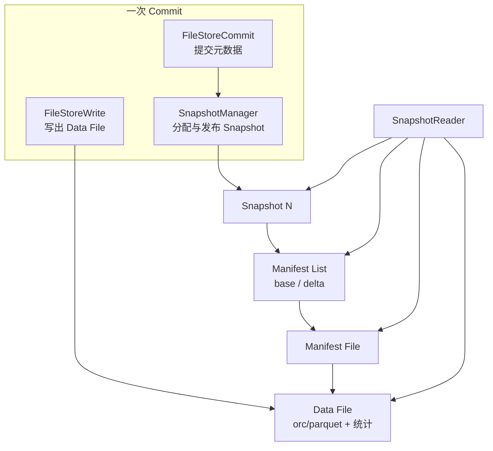

订单域和支付域做完 MySQL 到湖的链路之后，业务侧最常追问两句：「此刻湖里看到的是不是和源库同一时刻的一致性视图？」以及「对账差了几万行，能不能回滚到十分钟前再重算？」在 Paimon 里，这两类问题几乎都落在同一套元数据链路上：**Snapshot → Manifest List → Manifest File → Data File**。把这条链路吃透，后面谈主键表 LSM、Bucket、两阶段提交才有落脚点；否则一遇到「短暂少数据」「snapshot 暴涨」「手删文件表坏了」，只能靠猜。

本文以支付成功明细表 `dwd_pay_success`（主键 `pay_id`，按 `dt` 分区）和订单宽表 `dwd_order_wide` 的 CDC 入湖实践为背景，把表格式的设计意图、关键对象、一次真实 commit 在磁盘上留下的痕迹，以及我们踩过的对账读旧 snapshot 案例串起来。写法上尽量对齐社区实现里常见的类名：`SnapshotManager`、`ManifestFile`、`FileStoreWrite`、`FileStoreCommit`、`KeyValueFileStore` 等，方便对照源码，而不是只背概念图。

## 业务场景：为什么一线工程师必须关心「表格式」

链路是标准 CDC 入湖：

```text
MySQL binlog
  -> Flink CDC（支付库 + 订单库）
  -> Paimon 主键表 dwd_pay_success / dwd_order_wide
  -> Spark 批读做 T+0 对账、Flink Lookup 做实时补全、下游消费 changelog 做指标
```

大促第二天凌晨，对账作业报过一次「湖表比源库少约四万笔支付成功」。当时现象很典型：

1. Flink 作业 Checkpoint 全部成功，作业日志里 commit 也显示成功；
2. Spark 对账读湖，行数短暂少于源库；十分钟后再跑，行数对齐；
3. 运维去看表目录，`snapshot/` 下短时间新增了好几个文件，同时 compaction 也在跑。

不懂表格式的人会怀疑「Paimon 丢数」或「CDC 漏了」。懂的人会先问三句：你读的是哪个 snapshot？启动时钉死了 id 还是每次扫 LATEST？compaction 提交的中间 snapshot 有没有被你当成异常？这三句问清楚，一半「故障」其实是可见性与扫描模式问题，不是真丢数。

所以整体架构第一课，不是 API，也不是「湖仓一体」口号，而是：**一次写入如何变成一个可被读者钉住的 Snapshot，以及 Manifest 如何描述那一刻的文件集合**。

## 目录结构：打开一张表你实际看到什么

一张 Paimon 表在文件系统上大致是：

```text
warehouse/db.db/dwd_pay_success/
  schema/                 # schema-*.json，与 snapshot.schemaId 绑定
  snapshot/               # snapshot-N、EARLIEST、LATEST
  manifest/               # manifest-list-xxx、manifest-yyy
  dt=2026-04-01/bucket-0/ # 分区 + bucket 下的 Data File
  dt=2026-04-01/bucket-1/
  changelog/              # 视 changelog-producer 与表类型而定
```

逻辑关系可以概括成：



几个容易忽略的点：

- **不要用手列目录判断「数据在不在」**。真实可见集合以 Snapshot 引用的 Manifest 为准；目录里多出来的文件可能是未提交、已过期未清、或 compaction 新旧并存。
- **`EARLIEST` / `LATEST` 是指针文件**，方便快速定位范围。它们本身不是「数据」，清理策略会推动 `EARLIEST`，新 commit 会推动 `LATEST`。
- **分区目录与 bucket 目录只是物理布局**。读规划时还会结合 Manifest 里的统计做裁剪；布局乱了会影响性能，但一致性仍靠 Snapshot。

支付表我们约定：按 `dt` 分区、主键哈希到固定 bucket 数。bucket 数选错会直接表现为单 bucket 文件过大或过碎——那是后面 LSM 文要展开的，本文先假定布局已定，只谈格式层。

## Snapshot：版本号、一致性锚点、提交身份

`Snapshot` 可以理解为一次成功 commit 后的表状态声明。常见字段语义包括：

- `id`：单调递增的 snapshot id；
- `schemaId`：对应哪版 schema；
- `baseManifestList` / `deltaManifestList`：基线与增量 Manifest List 文件路径；
- `changelogManifestList`：若产出 changelog，指向 changelog 的 Manifest List；
- `commitUser` / `commitIdentifier`：谁提交、哪次提交（和 Flink checkpoint、两阶段提交强相关）；
- `totalRecordCount`、`deltaRecordCount` 等统计；
- `watermark`：流式场景下的水位信息（若启用）；
- 以及与 changelog、compaction 相关的附属信息（不同版本字段名可能微调，读源码以当前分支为准）。

读者通过「读到某个 Snapshot」获得 **snapshot isolation**：同一查询内看到的文件集合是冻结的，不会读到提交到一半的脏清单。这一点对对账至关重要——对账要的是「某一刻的全集」，不是「边读边变的模糊集合」。

`SnapshotManager` 在实现里负责 snapshot 文件的分配、写出、读取与（在 expire 时）回收。生产排查时，我们习惯先看：

1. `LATEST` 指向的 id；
2. 该 id 对应 snapshot 文件里的 `commitUser` / `commitIdentifier`；
3. `deltaRecordCount` 是否与本轮 Flink checkpoint 的写入规模同量级；
4. 是否同时存在 compaction 产生的额外 snapshot（行数变化不大，但文件集合变了）。

长时间跑的批作业若启动时解析了 snapshot id，中途 writer 提交新 snapshot **通常不会**自动改写该作业已选定的视图（具体还受 scan 模式、是否每次重新解析 LATEST 影响）。对账任务若「启动钉死」、writer 继续推进，就会出现开头那种「短暂少数据」。

## Manifest：文件清单，而不是数据本身

Manifest 解决的是「一张表几百万小文件时，总不能每次全表列目录」的问题。层级一般是：

1. **Manifest List**：一个 Snapshot 引用的 Manifest 文件列表。base 与 delta 分开，是为了增量合并与加速规划——高频小提交不必每次把整张表的文件清单重写一遍。
2. **Manifest File**：由 `ManifestFile` 一类组件读写，记录一批 Data File 的元数据——路径、分区、bucket、level、行数、最小最大 key、序列号范围、删除相关统计等。
3. **Data File**：真正的列存数据（以及主键表场景下的 key/value、序列号等）。

可以粗理解为：Snapshot 是版本，Manifest 是该版本下的「库存清单」，Data File 是货架上的货。Compaction、过期清理改的是清单和文件生命周期，而不是让读者去猜目录。

主键表场景下，Manifest 条目里的 **level**、**sequence 范围** 特别关键：读路径要根据 level 与合并策略决定哪些文件参与同一 key 的裁决；写路径在 commit 时要把新增文件、删除文件（被 compaction 替换掉的旧文件）正确登记进 delta Manifest。append 表没有那么重的 LSM 语义，但 Manifest 骨架是同一套。

对账任务慢，很多时候不是算子慢，而是 **Manifest 规划出的文件集太大**——分区裁剪、bucket 裁剪、min/max key 过滤任何一个没生效，都会把 IO 打满。我们排查过一次「只按 `pay_id` 点查却扫了大量文件」：原因是点查走了批读路径且分区谓词没推下去，Manifest 几乎按整天分区展开。修的是扫描入口和谓词，不是加机器。

## Data File：不可变文件 + 统计信息

Data File 一经写出通常视为不可变。更新靠「追加新文件 + 在更高层合并」完成（主键表），或靠新文件进入文件集合（append 表更简单）。文件内会有：

- 列统计、key 范围（用于谓词下推与文件裁剪）；
- 主键表下的序列号（sequence number），用于同 key 多版本裁决；
- level 信息（LSM 层次，L0 / L1+）；
- 格式相关元数据（orc/parquet footer 等）。

运维红线：**禁止手删「看起来没用的 orc/parquet」**。有人只看数据目录不看 Snapshot，把 compaction 尚未从 Manifest 摘掉、或仍被旧 Snapshot 引用的文件删了，结果是表直接不可读。规范应是走 remove / expire / 官方清理接口，让 `SnapshotManager` 与 Manifest 链路一起收口。

## 一次 commit：从 FileStoreWrite 到 FileStoreCommit

以 Flink 流写 `dwd_pay_success` 为例，单次成功 checkpoint 对应的 commit 可简化成：

1. **Write**：各并发 writer 经 `FileStoreWrite`（主键表侧常落到 `KeyValueFileStore` 写路径）按分区 + bucket 把缓冲中的记录刷成一个或多个 Data File，落在对应 `dt=.../bucket-N/`。
2. **收集增量**：每个 writer 上报本轮新增/删除的文件变更（Change 集合）。删除往往不是「改文件内容」，而是「旧文件从新 Snapshot 的 Manifest 中消失，并在合适时机物理删除」。
3. **Commit**：`FileStoreCommit` 基于上一个 Snapshot，合并 base/delta Manifest，写出新的 Manifest List，再由 `SnapshotManager` 原子地写出 `snapshot-(N+1)`，并更新 `LATEST`。
4. **冲突检测**：若并发 commit 发现 base Snapshot 已被别人推进，需要重试或按规则合并。流式作业通常靠单一 committer 降低冲突，但批写、多作业共写同一张支付表时必须认真对待——我们见过「重写历史分区的批作业」和「实时 CDC」抢 commit，导致重试风暴、checkpoint 变长。

支付场景里我们踩过的点（都和格式层直接相关）：

- **commit 成功但下游立刻读仍偏旧**：下游用了 `latest` 的缓存间隔，或 catalog 元数据刷新偏慢；短时间「少几万」不一定是丢数。
- **snapshot 暴涨**：checkpoint 过密 + 每次 commit 都带 compaction 产物，Manifest 与 Snapshot 文件变多；需要配合 `snapshot.time-retained` / `num-retained` 清理，否则 NameNode 或对象存储 LIST 都会难受。
- **只看数据目录不看 Snapshot**：手删导致 Snapshot 指空。
- **对账作业钉死旧 Snapshot**：下一节展开。

两阶段提交视角：Flink 的 checkpoint barrier 与 Paimon 的 `commitIdentifier` 对齐后，才能保证「算子状态恢复」和「表 Snapshot」指向同一逻辑提交。排查「重启后重复」或「重启后缺口」时，不要只看 Flink，也要看 Snapshot 上挂的提交身份是否与预期一致。

## 生产案例：对账读到旧 Snapshot

回到开头的大促现象。最终结论是：

1. Writer 在 `snapshot-1052` 提交成功，支付成功增量已进湖；
2. 对账 Spark 作业启动时解析到的是 `snapshot-1050`（会话内固定），少了约两分钟的增量，差额大约四万笔；
3. Compaction 同时提交了 `snapshot-1051`，让运维看到短时间多个 Snapshot，误判为异常抖动。

处理上没有「修数据」，而是改读侧约定与监控：

- 对账任务明确 `scan.snapshot-id`，或确保读 LATEST 且在 writer 静默窗口启动；需要「与源库某一秒对齐」时，用事件时间水位 + Snapshot 元数据交叉验证，而不是只比行数。
- 监控上同时报「最新 Snapshot id」「表最大事件时间」「delta 行数」，避免只盯行数。
- 禁止在高峰对同一主键表并发跑「重写历史分区」的批作业，减少 commit 冲突重试。
- 对账报告里带上所用 Snapshot id，事后可复现，避免口头对线。

这个案例的价值在于：它证明了 **表格式不是文档装饰，而是故障定位坐标系**。没有 Snapshot id，你无法向业务解释「少四万」到底是延迟可见、扫描钉死，还是真故障。

## Schema 与 Snapshot 的关系

`schema/` 下的版本与 Snapshot 的 `schemaId` 绑定。加列、改类型会生成新 schema；老 Snapshot 仍指向老 `schemaId`。这意味着：

- 时间旅行读旧 Snapshot 时，要用当时的 schema 解释文件；
- 不兼容变更要有迁移策略，而不是假定所有历史文件都能被新 schema 无痛读出。

支付表一次「金额字段从 decimal(18,2) 扩到 decimal(20,2)」的变更，就是先升 schema，再双跑校验，最后切读。中间若有作业钉死旧 Snapshot 做重跑，行为是可预期的——这也是表格式设计的红利：版本不仅钉住文件，还钉住解释文件的 schema。

订单宽表后来加过「支付渠道」列，下游有的作业从旧 Snapshot 做补数，有的从新 Snapshot 做增量。两边 schema 不一致时，合并结果必须显式处理缺列默认值，不能假装「湖表永远最新结构」。

## Append 表与主键表在格式层的共同点

很多人把 Paimon 等同于「主键 LSM 表」。格式层其实两者共享 Snapshot / Manifest 骨架：

| 维度 | Append 表 | 主键表 |
| --- | --- | --- |
| 一致性锚点 | Snapshot | Snapshot |
| 文件清单 | Manifest List / Manifest File | 同左 |
| 写路径组件 | FileStoreWrite / FileStoreCommit | 同左，常经 KeyValueFileStore |
| 更新模型 | 追加文件进入集合 | LSM + sequence 合并 |
| Changelog | 可选 | 常与 changelog-producer 绑定 |
| level / sequence | 弱或无 | 核心 |

先把共享骨架弄清，再进 LSM，不会把「版本管理」和「合并引擎」搅在一起。支付成功明细用主键表，是因为 CDC 有更新与撤回；某些只追加的支付流水镜像可以用 append 表降低合并成本——选表类型是业务决策，但 **回滚、对账、清理** 仍然走同一套 Snapshot 语义。

## 和 Iceberg / Hudi 对照时怎么看

架构对比时不必陷入品牌之争，抓三点即可：

1. **版本对象**：都有类似 snapshot/commit 的版本；Paimon 的 Snapshot 与流式 watermark、changelog 绑定更紧，适合 CDC 入湖后既要批读又要流读。
2. **清单层级**：都有多层元数据避免列目录；Paimon 的 base/delta Manifest 切分偏向高频小提交。
3. **主键更新**：Paimon 主键表走 LSM 风格合并；这是业务选它做支付/订单 CDC 入湖的重要原因。

支付明细这类「变更频繁、要对账、要近实时」的表，选 Paimon 往往是因为：**流式写入 + 快照读 + changelog 消费** 在一个表格式里闭环。格式层先立住，后面 compaction 参数、changelog-producer 模式才有调参空间。

## 组件视角：建议的读源码路径

若去翻实现，建议按调用链读，而不是按包名扫：

```text
Catalog / Table
  -> FileStore / KeyValueFileStore（表存储抽象）
    -> FileStoreWrite（写 Data File、收集文件变更）
    -> FileStoreCommit（合并 Manifest、冲突检测）
    -> SnapshotManager（分配、发布、过期 Snapshot）
    -> ManifestFile / Manifest List（清单读写与合并）
    -> SnapshotReader（按 Snapshot 规划文件集）
```

关注点建议钉死三条：

1. Snapshot 如何原子发布（写临时文件再 rename / 写 LATEST 的顺序）；失败半提交时读者为何仍安全。
2. Manifest 合并何时触发、如何避免每次全量重写；base/delta 在高频 checkpoint 下如何演进。
3. Reader 如何根据 partition filter、bucket filter、统计信息裁剪文件；点查与全分区扫描在 Manifest 规划上的差异。

把这三条在源码里走通，线上「慢、旧、回滚」三类问题就有了统一解释框架。下一篇会在这个骨架上展开主键表的 LSM、`CompactManager`、changelog-producer 与 sequence 裁决——那才是 CDC 场景下 CPU 与小文件问题的主战场。

## 运维与排障清单（格式层）

结合支付/订单入湖，格式层日常我们盯这些：

- Snapshot 增长速度是否与 checkpoint 间隔、compaction 频率匹配；
- Manifest 文件数量与单个 Manifest 体积是否异常膨胀；
- `EARLIEST` 推进是否落后导致历史 Snapshot 与文件堆积；
- 对账与核心报表是否记录所用 Snapshot id；
- 是否存在多 writer 共写导致的 commit 冲突重试；
- schema 变更后是否仍有作业钉在旧 `schemaId` 的 Snapshot 上补数。

出现「行数对不上」时的固定顺序：**先 Snapshot，再 Manifest 规划出的文件数与行数统计，再抽样 Data File，最后才怀疑 CDC 源端**。顺序反了会浪费大量时间在源库和 Flink 日志里空转。

## 深入：base Manifest 与 delta Manifest 为何要拆

高频 CDC 写入下，每一次 checkpoint 都可能产生新的 Data File。如果每次 commit 都把「全表所有文件清单」重写成一份巨大 Manifest，提交延迟和元数据写放大都会很难看。拆成 base 与 delta 的直觉是：

- **base**：相对稳定的基线文件集合，描述「已经沉淀下来的大部分文件」；
- **delta**：相对本轮或近期的增量变更，描述「新增了哪些、从可见集合里拿掉了哪些」。

`FileStoreCommit` 在推进 Snapshot 时，会按策略决定何时把多段 delta「折叠」回新的 base，避免 delta 链无限变长。折叠本身也是一次元数据整理，和数据面的 compaction 不是一回事，但两者常在相邻 Snapshot 里一起出现，容易让运维误判「怎么又多了几个版本」。

支付表在大促高峰，我们见过 delta Manifest 数量短期爬升：不是丢数，而是提交太密、折叠跟不上。处理方式是适当拉长 checkpoint、控制无意义的空提交、让 expire 与 Manifest 合并策略匹配写入频率。对象存储上，Manifest 小文件过多时 LIST 与随机读成本同样可观，别只盯 Data File。

从 `ManifestFile` 读写接口往下看，每条文件元数据大致要能支撑三类决策：

1. **能不能裁掉**：分区、bucket、key 范围、统计信息；
2. **合并时怎么处理**：level、序列号范围、删除比例；
3. **过期时能不能删**：是否仍被某 Snapshot 引用（这通常由 Snapshot 保留集与引用计数/扫描共同保证，而不是单看目录）。

读源码时建议把「Manifest 条目字段」打印或在调试环境里 dump 几条真实支付表示例，比只看文档字段表更快建立直觉。

## 深入：Snapshot 原子发布失败时读者为什么通常仍安全

原子性是湖表格式的底线。实现上常见套路是：先把 Manifest List、Snapshot 内容写到临时路径或完整写出新 snapshot 文件，再更新 `LATEST` 指针；中途进程崩溃时，读者仍跟着旧的 `LATEST` 走，看不到半截清单。`SnapshotManager` 的职责之一，就是把「分配下一个 id、写出、发布、异常时不暴露脏版本」收口。

生产上仍可能遇到「目录里多了孤立文件」：写成功但未进入任何 Snapshot 的 Data File，或 commit 重试留下的临时产物。它们不该被业务读到，但会占空间。清理要走官方过期与孤儿文件清理逻辑，确认没有 Snapshot 引用后再删。支付表磁盘报警时，先区分「被 Snapshot 引用的有效数据」和「孤儿/过期未清」，避免手快酿成更大事故。

另一类问题是 **时钟与水位**：Snapshot 上的 watermark 与业务事件时间不是同一概念。对账若用事件时间窗口，却用「Snapshot 提交墙钟时间」当对齐点，会系统性偏几分钟。我们要求对账报告同时打印：Snapshot id、Snapshot 时间相关字段、表内最大支付成功时间、源库抽样位点时间。四者对齐后，再谈差额。

## 案例补遗：回滚十分钟前重算

业务曾要求：「支付对账口径改了，用十分钟前的湖表状态重跑。」操作上不是回退 Flink 状态那么简单，而是：

1. 找到目标时刻前后的 Snapshot id（结合提交时间与 watermark）；
2. 批作业显式 `scan.snapshot-id` 钉住该版本；
3. 确认该 Snapshot 尚未被 expire 掉，且 schemaId 仍可被当前引擎解释；
4. 重跑结果写入独立结果表，避免覆盖线上正在推进的最新视图。

若 `EARLIEST` 已经推过目标 id，回滚失败——这是保留策略问题，不是 Paimon「不支持时间旅行」。支付核心表我们把 num/time retained 设得比普通明细更保守，就是给这类重算留窗口。代价是元数据与文件占用更多，需要容量规划，不能只抄默认值。

订单宽表有一次 expire 配得太激进，下游流读 changelog 的消费进度还停在两小时前，结果作业重启后找不到历史 changelog 范围。格式层的结论是：**Snapshot 保留必须覆盖最慢消费者**，包括批对账的「可回滚窗口」和流作业的「可重放窗口」。

## 多作业共写时格式层如何表现

实时 CDC 与「历史分区修复」共写同一张 `dwd_pay_success` 时，格式层常见现象：

- commit 冲突重试增多，`FileStoreCommit` 日志里 base Snapshot 已被推进；
- Snapshot id 跳动变快，但单次 delta 行数不一定大；
- compaction 与业务写入抢资源，Manifest 变更更频繁；
- 对账若未钉 Snapshot，两次启动读到不同版本，差额无法复现。

治理原则很土但有效：**一张核心主键表同一时刻只允许一个主 writer**；修复走独立窗口或独立表替换分区。格式层提供了冲突检测，但它不能替你做资源与发布管理。把冲突检测当成「可以随便共写」的绿灯，是我们早期付过学费的误读。

## 从支付字段变更看 schema 演进的实操顺序

除了 decimal 扩位，支付表还加过「清算机构」字段。实操顺序我们固化成：

1. 发新 schema（`schema/` 新增版本），确认作业与引擎版本支持；
2. 双跑：旧作业写旧逻辑，新作业写含新列的路径，或同一作业兼容读写；
3. 用指定 Snapshot 做抽样校验：新列空值率、与源库对照；
4. 下游切换读新 Snapshot / 新 schema；
5. 旧补数作业若必须跑，显式声明其 Snapshot 与 schemaId，避免静默按新 schema 解释旧文件。

这里再次体现格式设计：`schemaId` 挂在 Snapshot 上，时间旅行不是「永远用最新表结构读任意历史」，而是「用当时的结构读当时的文件集合」。一线文档里把这点写清楚，能减少一半跨组扯皮。

## 读路径规划：为何「对账慢」经常是 Manifest 问题

Spark 对账慢时，执行计划看起来在扫表，实质瓶颈常在：

- 分区谓词没推到扫描层，Manifest 展开了过多分区；
- bucket 裁剪无效，点查变成扫所有 bucket；
- 统计信息缺失或过粗，key 范围过滤失败；
- 小文件过多，任务启动与脚注读取开销压过解压计算本身。

所以格式层优化和对账 SQL 优化是一件事的两面。先让 `SnapshotReader` 规划出的文件集变小，再谈算子参数。我们有次把对账从「扫三天支付分区」改成「钉 Snapshot + 单日分区 + 必要字段裁剪」，时长从小时级回到十几分钟，期间没加集群配额。

## 小结

Paimon 表格式的骨干是一条很克制的链：

**Data File 不可变存放数据 → Manifest 描述文件集合 → Snapshot 钉住某一刻的集合与统计 → Reader 按 Snapshot 做隔离读。**

`FileStoreWrite` 负责把变更落成文件，`FileStoreCommit` 与 `SnapshotManager` 负责把文件集合变成可共享的版本，`ManifestFile` 让版本可规划、可裁剪。支付与订单 CDC 入湖场景里，大多数「丢了 / 多了 / 回不去」的恐慌，先回到这条链上定位，再决定是扫描模式问题、清理问题还是真正的写入故障。

格式层立住之后，主键表的合并引擎才有讨论意义：同一 key 多版本如何用 sequence number 裁决、L0 如何归并到 L1+、changelog 如何在 compaction 时产出——那是下一篇的内容。
