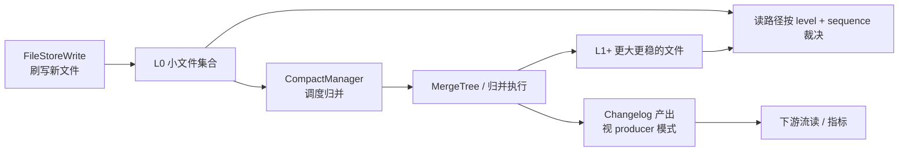

上一篇把 Snapshot / Manifest / Data File 骨架理清了。支付和订单 CDC 入湖真正吃资源的地方，往往不在「能不能提交」，而在 **主键表如何把同 key 的多版本收成一张可读视图**，以及 **compaction 如何一边归并文件一边（按模式）产出 changelog**。线上最常见的两类痛：小文件把 NameNode 或对象存储 LIST 拖垮；compaction 把 CPU 打满，实时作业背压。两边看起来相反，根子都在 LSM 与合并策略。

本文继续用 `dwd_pay_success`（主键 `pay_id`）和 `dwd_order_wide`（主键 `order_id`）的生产经验，把 L0/L1+ 归并、`CompactManager` 的角色、changelog-producer 几种模式、sequence number 裁决，以及一次「小文件 + CPU 打满」的复盘写清楚。组件名尽量对齐：`KeyValueFileStore`、`FileStoreWrite`、`FileStoreCommit`、`CompactManager`、`MergeTree`、`Changelog`、level、sequence number。

## 业务场景：CDC 入湖为什么绕不开 LSM

链路不变：

```text
支付/订单 MySQL binlog
  -> Flink CDC
  -> Paimon 主键表
  -> 批读对账 + 下游消费 Changelog 做指标/宽表
```

CDC 的特点是：**同一主键会反复出现**——支付成功后的状态回写、订单状态机从待支付到已支付到已完成、偶发的撤回与更正。若每次变更都当成 append 堆文件，批读要对同 key 做全局去重，成本不可接受；若每次原地改文件，又失去湖格式的不可变与 Snapshot 隔离。

主键表的折中是 LSM 风格：新变更写到较浅的 level（常见是 L0 一类），后台 compaction 把文件归并到更深 level，读时按 level 与 sequence 裁决出「当前值」。Changelog 则是这条合并链路上的「变更对外可见形态」——下游不必自己扫全量再算 diff。

## LSM 在 Paimon 主键表里长什么样

可以先把层次记成：



要点：

- **L0**：通常承接新鲜写入，文件多、体积小、key 范围可能重叠严重。读 L0 成本高，因为同 key 可能散落在多个文件，必须靠 sequence 比出胜者。
- **L1 及更深**：compaction 目标是让同区间文件更少、重叠更可控，读路径更稳。不是「越深越好」无脑堆层，而是在写放大、读放大、空间放大之间找平衡。
- **Manifest 仍然描述一切**：哪些文件在哪个 level、序列号范围多少，都在 Manifest 条目里；compaction 提交仍走 `FileStoreCommit` + `SnapshotManager`，只是变更集合里多了「删旧文件、加新文件、可能加 changelog 文件」。

`KeyValueFileStore` 把主键表的 key/value、sequence、value kind（增删改语义）收进统一存储抽象；`FileStoreWrite` 负责把缓冲刷成带 level 信息的 Data File；真正「何时合并、合并谁」则更多落在 `CompactManager` 与底层的 `MergeTree` 归并逻辑上。

## sequence number：同 key 多版本怎么裁决

支付表里，同一 `pay_id` 可能在短时间出现多条变更：先 insert 成功记录，再 update 渠道字段，再偶发 correction。文件里若只存「最新一行」而不带版本语义，compaction 与乱序写入会很难做对。

**sequence number**（序列号）就是裁决依据：同主键下，序列号更大的版本胜出；删除语义通过 value kind 等标记表达，合并时按规则折叠。读路径和 compaction 路径必须遵守同一套裁决，否则会出现「批读结果」和「changelog 下游」不一致——对账时这是灾难。

生产上要注意：

1. **序列号从哪来**：通常与写入过程分配相关，和引擎侧的顺序、bucket 内局部顺序绑定；跨作业乱写同一主键表时，要保证不会破坏「业务上的先后」与「序列号先后」的一致性假设。
2. **乱序 binlog**：CDC 一般按事务与位点有序，但多源合流、重放、补数作业插入历史分区时，可能引入「业务时间旧、序列号新」或相反的情况。补数要用明确策略（覆盖窗口、独立临时表再交换），不要和实时写入抢同一套裁决而不声明规则。
3. **Manifest 上的序列号范围**：用于规划与裁剪；不等于你可以跳过裁决。范围只是加速，最终同 key 仍要按完整规则合并。

订单宽表曾出现过「补数作业把三天前状态写进当天分区」导致短暂状态回退：根因是补数路径的序列号策略与实时路径不一致。修法是补数走受控的 batch 写入并提高序列号水位，或对历史分区做隔离重写后再切读，而不是在实时表上「悄悄插旧状态」。

## CompactManager：谁在决定「合并什么」

`CompactManager` 可以理解为 compaction 的调度与协调者：它决定何时触发、挑选哪些文件进入一次归并、把任务交给执行层（常与 `MergeTree` 一类结构协作），并在完成后把结果文件交回提交链路。

一线体感上，它管三件事：

1. **触发**：写路径达到阈值文件数、大小、间隔，或显式 full-compaction；流式作业里常和 checkpoint / 写批次耦合。
2. **选文件**：优先消解 L0 堆积、重叠严重的区间、过小文件；选错会要么永远合并不过来，要么合并过大打爆 CPU。
3. **与可见性协作**：归并产物必须通过 `FileStoreCommit` 进入新 Snapshot 才对读者可见；旧文件在仍被旧 Snapshot 引用时不能物理删光。

调参不是背配置项，而是回答：当前支付表的痛点是 **L0 文件数**、**读放大**，还是 **changelog 产出延迟**？三者对应的 compaction 激进程度不同。盲目把 compaction 调猛，CPU 先炸；调太弱，小文件和读延迟后炸。

## L0 到 L1+：归并在磁盘上留下什么

一次典型的 L0 归并可以描述为：

1. `CompactManager` 选出一组 L0（及可能的下层重叠文件）；
2. 执行层按 key 排序/归并，用 sequence number 折叠同 key，写出新的 Data File，level 提升到 L1（或策略规定的目标层）；
3. 变更集合：删除参与归并的旧文件条目，增加新文件条目；若 changelog-producer 需要，同时产出 Changelog 相关文件；
4. `FileStoreCommit` 提交新 Snapshot；读者从新 Snapshot 起看到更「干净」的文件集。

支付大促时 L0 堆积的典型曲线：checkpoint 间隔短 → 每轮刷出大量小文件 → L0 文件数陡增 → 读对账变慢 → 运维把 compaction 调激进 → CPU 打满 → 写入背压 → checkpoint 变长 → 更夸张的小文件潮。这是正反馈，必须在「写入批量」和「合并强度」两侧同时拆，而不是只拧一个旋钮。

## changelog-producer：lookup / input / full-compaction 等模式

下游若要「像读 binlog 一样读湖表变更」，依赖 changelog。主键表的 changelog-producer 常见思路（名称以你使用的版本文档为准，语义比名字重要）：

- **input**：相对贴近输入变更，产出成本较低，但对「什么算完整 changelog」的保证较弱，适合能容忍或自行处理完整性的下游。
- **lookup**：在写入或相关路径上通过查找旧值来生成更完整的更新前后镜像，正确性强，但点查/查找成本高，容易成为 CPU 与 IO 热点——支付高 QPS 表要谨慎评估。
- **full-compaction**（或与全量 compaction 绑定的产出方式）：在较完整的归并过程中产出 changelog，正确性与合并绑定，延迟取决于 compaction 频率；对「要完整变更、又能接受分钟级延迟」的指标链路很常见。

选型要贴业务：

- 实时风控要秒级变更：更关注低延迟产出，可能付出 lookup 成本或接受 input 语义并在下游补齐。
- 对账与日终指标：更在意完整与可复现，full-compaction 一类往往更稳。
- 同一张 `dwd_pay_success` 被多种下游消费时，不要假设一种 producer 能同时最优；必要时拆表或拆链路。

Changelog 文件同样进入 Manifest / Snapshot 体系（例如 snapshot 上的 changelog Manifest List）。清理 Snapshot 时要意识到：下游若还在消费旧 changelog 范围，过早 expire 会让流读断档。支付指标作业挂掉两小时再起来，就依赖 changelog 与 Snapshot 保留策略是否覆盖得住。

## 生产案例：小文件与 CPU 同时打满

事件发生在订单宽表 `dwd_order_wide` 大促后的工作日。症状：

1. 实时 Flink 作业 CPU 长期接近打满，checkpoint 从一分钟漂到数分钟；
2. 表目录下单分区 bucket 内小文件数量异常高；
3. 批读对账变慢，Manifest 规划出的文件数比平日高一个数量级；
4. 下游 changelog 消费延迟升高，指标看板抖动。

排查顺序（建议固定成习惯）：

1. **看 Snapshot 速率与 delta 文件数**：确认是写入过碎，还是 compaction 提交过频，或两者叠加。
2. **看 level 分布**：L0 是否堆积；若 L0 文件数持续高于水位，说明合并跟不上写入。
3. **看 CompactManager 相关指标/日志**：合并任务是否堆积、单次合并输入文件是否过大、是否与 lookup 型 changelog 叠加。
4. **看是否多作业共写**：当天有人在跑历史分区重刷，和实时 CDC 抢同一张表的 commit 与 compaction 资源。

根因复盘（压缩表述）：

- checkpoint 间隔过短，且写入缓冲偏小，导致 L0 小文件暴涨；
- changelog-producer 使用了成本偏高的模式，在合并与查找上叠了额外 CPU；
- 同时有批作业重写历史分区，触发额外 compaction 与 commit 冲突重试；
- 运维先把 compaction 调得更激进，短期 L0 下降，但 CPU 直接顶满，写入更慢，形成恶性循环。

处理动作（按优先级）：

1. **先止血**：暂停非必要历史重刷；临时加大写入批量/略放宽 checkpoint，降低 L0 产生速率；把 compaction 从「全力」调回可控并发。
2. **再选型**：评估 changelog-producer 是否必须用高成本模式；对账链路改为扫 Snapshot 全量，指标链路单独评估延迟与完整性。
3. **后治理**：调整 bucket 数与目标文件大小，设定 L0 文件数告警，禁止高峰共写，Snapshot/Changelog 保留与下游消费进度挂钩。
4. **验证**：L0 文件数回落、checkpoint 稳定、对账文件数恢复、CPU 回到日常水位后，再恢复历史重刷到独立窗口。

这个案例说明：`CompactManager` 不是「打开就好」的后台魔法，它是资源调度器。你给它的输入（小文件速率、查找成本、共写冲突）决定了它会救场还是放火。

## 写路径与读路径如何咬合

写路径简化：

```text
记录进入 bucket
  -> FileStoreWrite / KeyValueFileStore 缓冲
  -> 刷写 Data File（带 sequence、level）
  -> 变更集合上报
  -> 可能触发 CompactManager
  -> FileStoreCommit 发布 Snapshot（含数据与可能的 Changelog）
```

读路径简化：

```text
解析 Snapshot（LATEST 或指定 id）
  -> 读 Manifest List / Manifest File
  -> 按分区、bucket、统计、level 规划文件
  -> 多文件归并读取，按 sequence 裁决同 key
  -> 批读得到当前视图；或流读 Changelog 得到变更
```

对账要用「当前视图」，指标增量常用 Changelog。两者不一致时，优先怀疑：读的 Snapshot 不同、changelog 延迟、或 producer 语义与预期不符——而不是先改业务 SQL。

## 与格式层的衔接（避免概念打架）

再强调一次边界：

- **Snapshot / Manifest**：解决版本与文件集合；
- **LSM / CompactManager / sequence**：解决主键多版本与文件归并；
- **Changelog**：解决变更如何对外流出。

手删 Data File、乱调 expire、多作业无协调共写，会同时打穿这三层。支付/订单这类核心表，变更要走评审：表类型、bucket、changelog-producer、compaction 目标、Snapshot 保留，最好写成表级约定，而不是口头传。

## 调参与观测：一线够用的最小集

不必一次上齐所有指标，先盯这些：

- 每分区每 bucket 的文件数、L0 占比；
- 最近 N 个 Snapshot 的 delta 文件数与记录数；
- compaction 队列长度、单次合并耗时、失败重试；
- checkpoint 时长与 commit 冲突次数；
- changelog 消费延迟（若有下游）；
- 对账任务规划文件数与扫描时长。

告警建议「文件数 + CPU + checkpoint」三联，避免只对 CPU 告警然后盲目加压 compaction。

## 读源码时怎么跟合并链路

在上一篇 Catalog → FileStore 路径基础上，主键表合并建议再跟：

```text
KeyValueFileStore
  -> FileStoreWrite（写与触发压缩的入口之一）
  -> CompactManager（调度）
  -> MergeTree / compact 执行（归并、裁决、写出）
  -> Changelog 产出逻辑（按 producer 模式分支）
  -> FileStoreCommit（登记新文件、剔除旧文件、挂 Snapshot）
```

阅读时带着支付表的问题问：L0 选文件策略是什么？sequence 比较在哪一层做？lookup 旧值从哪读？full-compaction 与日常增量 compact 如何区分提交？这几个问题在源码里落点清楚后，线上调参才不会凭感觉。

## 深入：写放大、读放大、空间放大在支付表上的体感

LSM 教科书里的三种放大，落到支付 CDC 表可以这样翻译：

- **写放大**：同一笔支付状态被反复归并进更深 level，磁盘写入量远大于原始变更量。compaction 越激进、level 策略越碎，写放大越明显。大促后磁盘带宽打满，不一定是业务流量本身，可能是合并在重放历史小文件。
- **读放大**：一次点查或短区间扫描触及过多重叠文件，尤其是 L0 堆积时。对账全分区扫描在文件数爆炸时，任务数与脚注读取会先崩。
- **空间放大**：新旧文件在 Snapshot 保留窗口内并存，表「逻辑行数」不变，物理占用却上跳。expire 太慢就一直贵，太快又影响回滚与 changelog 重放。

调参本质是选哪一种放大你更愿意付。支付对账更怕读放大（算得慢、对不齐时段），实时作业更怕写放大与 CPU（checkpoint 漂）。不能只按「文件数好看」做唯一优化目标。

## 深入：MergeTree 归并时删除与更新如何折叠

订单状态机常见：`created → paid → fulfilled → closed`，中间还可能有逆向。主键表文件里往往以 key/value + value kind 表达插入、更新、删除。`MergeTree` 一类归并执行在合并多路有序输入时，按主键对齐，再用 sequence number 决定保留哪条，删除标记可能把更早的插入折掉。

需要警惕的边界：

1. **删除后的复活**：业务上先删后插同一 `order_id`（少见但补数会发生），序列号必须正确反映先后，否则会出现「删掉了还在」或「不该复活却复活」。
2. **跨分区主键**：若分区键与主键设计不当，同一业务实体落在不同分区，LSM 合并无法跨分区帮你去重。支付表用 `dt` 分区时，要确保业务上「同一 pay_id 不会跨天分裂成多个当前值」或接受跨分区查询自己合并。
3. **部分列更新**：宽表只更新少数列时，合并产物仍是整行语义还是带部分更新语义，取决于写入路径如何构造 value；补数作业若只写了部分字段的「假整行」，会把其它列打空。这是业务写入契约问题，合并引擎只会忠实按序列号覆盖。

我们在订单宽表补数时强制「整行重写或明确使用部分更新 API」，禁止在不了解 value 构造的情况下往主键表塞「半行」。

## changelog 与 Snapshot 消费进度如何对齐

流式下游消费 Changelog 时，进度通常要能回答：我消费到了哪个 Snapshot 范围或哪段 changelog 文件？支付指标作业重启后，若从错误位置续读，会出现重复计数或缺口。实践建议：

- 把消费进度与 Snapshot id / changelog 文件名一起持久化；
- 保留策略显式覆盖「最慢下游 + 安全余量」；
- 对账用批读当前视图做日终校准，不把 changelog 流当成唯一真相；
- 切换 changelog-producer 模式视为不兼容变更，需要下游重置或双跑验证。

有一次指标组只盯 Kafka 习惯，把湖表 changelog 当成「一定 exactly-once 到人」。实际上端到端语义取决于提交、保留、下游幂等三层。LSM 与 producer 保证的是表内一致与可产出变更，不是替下游保证「你的 SUM 永远不重不漏」。日终用 Snapshot 批读校准，是我们保留的兜底。

## 再谈 lookup 模式的成本结构

若 producer 走 lookup 思路，核心成本是：**为了生成更新前镜像，要能找到旧值**。旧值可能来自本地状态、磁盘文件点查或两者结合。支付高基数主键下，点查命中 L0 重叠文件时尤其贵——每一次变更都可能触发额外读放大。

何时还愿意用：下游强依赖完整更新前后镜像，且 QPS 可承受，或 bucket 设计让点查足够局部。何时该放弃：CPU 已在 compaction 边缘，再叠加 lookup 会把实时链路拖死。那时更现实的做法是 full-compaction 绑定产出，或接受 input 语义并在下游用状态补齐。

选型会写进表级约定，避免不同业务方各自「优化」把同一张表拧成互相矛盾的模式。

## CompactManager 与 FileStoreWrite 的协作节奏

写路径并不是「先写完所有业务文件，再完全异步随便合」。很多实现里，`FileStoreWrite` 在刷写或提交准备阶段就会与 `CompactManager` 交互：上报新文件、获取压缩结果、把压缩产出一并纳入本轮或后续 commit。节奏过密时，用户写入与压缩产出挤在同一批 Snapshot 里，表现为 Snapshot 多、文件集合变化大、对账若钉不住版本就容易慌。

可操作的观察方法：对比相邻 Snapshot 的文件增删——若大量「删旧加新」且 delta 业务行数不大，多半是 compaction 主导；若主要是「只增文件」且行数大，多半是业务写入主导。支付大促值班时，把这两种 Snapshot 分开看，能少很多误判。

## 小文件治理的具体杠杆（按优先级）

结合前面案例，杠杆从「先止血」到「后结构」排序：

1. **降低 L0 产生速率**：加大缓冲、合理 checkpoint、避免无意义小批量；
2. **控制合并并发与选文件规模**：让 `CompactManager` 有稳定吞吐，而不是一阵狂奔；
3. **评估 changelog-producer 成本**：该降级就降级；
4. **避免共写**：修复与实时隔离；
5. **调整 bucket 数与目标文件大小**：结构问题用结构手段，别只靠合并硬吞；
6. **分区策略**：过细分区会把小文件问题乘到每个分区上，支付按天通常够用，按小时要额外证明。

做完 1～4，多数表会明显好转；5～6 属于表设计变更，需要业务窗口。

## 与 append 表对比：何时不该上主键 LSM

不是所有支付相关表都要主键表。若数据是「只追加的支付流水镜像」，且下游从不靠湖表做主键更新，append 表能省掉大量合并与 sequence 裁决成本。我们把「当前状态表」和「流水事实表」拆开：状态表走主键 LSM，流水表走 append。格式层 Snapshot 仍然统一，合并压力只落在真正需要的表上。这是架构选择，不是调参能替代的。

## 值班清单：合并链路十分钟定位

接到「主键表又慢又烫」时，按这个顺序问：

1. 现在 L0 文件数相对基线如何？
2. 最近 Snapshot 是写入型还是压缩型？
3. `CompactManager` 是否在堆积或疯狂成功？
4. changelog-producer 模式是什么，有没有最近变更？
5. 是否有第二 writer？
6. 对账慢是不是规划文件数暴涨？
7. sequence / 补数作业有没有在动历史？

七个问题答完，处理方向基本就定了。再下去才是翻 `FileStoreCommit` 冲突日志和具体合并任务。

## 收尾前补一句工程习惯

主键 LSM 相关变更尽量「一次只动一个旋钮」：先改 checkpoint 或缓冲，观察 L0；再动 compaction 并发；最后才动 changelog-producer。支付与订单表上同时改三处，出了问题你分不清是哪一刀生效。值班文档里记下每次变更的 Snapshot 区间与文件数曲线，比事后凭记忆复盘可靠得多。`CompactManager`、`MergeTree`、sequence 裁决这些机制本身是稳定的，不稳定的往往是我们叠加在上面的发布节奏与共写方式。把「变更可回放、指标可对比、对账可钉住 Snapshot」当成发布门禁，合并链路的问题会少很多。

## 小结

主键表把 CDC 入湖的「更新」落成了可运维的机制：**新变更进浅层文件，CompactManager 驱动向 L1+ 归并，sequence number 保证同 key 裁决一致，changelog-producer 决定变更如何对外可见，一切仍通过 Snapshot / Manifest 发布。**

支付与订单场景里，小文件和 CPU 打满常常是同一枚硬币的两面。治理顺序应是：先看 level 与写入速率，再看 producer 成本与共写，最后才拧 compaction 并发。表格式骨架加上本篇的合并机制，Paimon 主键表在生产上才算「能讲清楚、能调得动、能对得上账」。遇到差额时先分清是可见性、合并延迟还是真写入故障，再决定动哪一层——这比连夜加机器有用。把结论写进值班手册，下次才能少走弯路。下一篇会顺着读写路径与并发控制，把 commit 冲突和 snapshot isolation 再展开一层。
