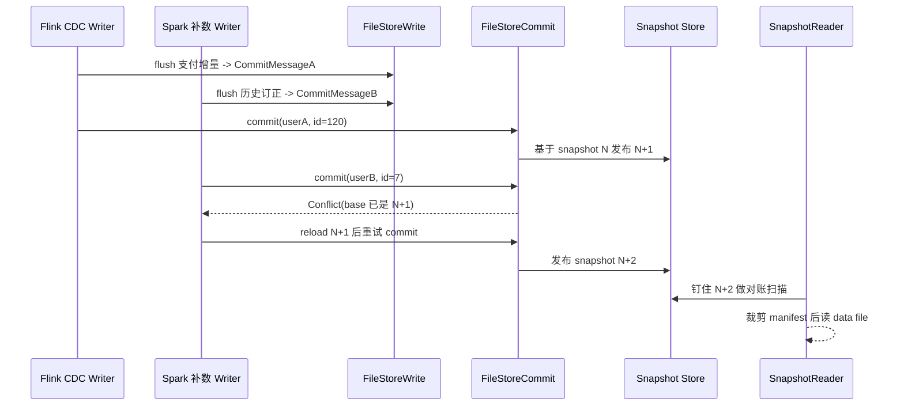

订单域 CDC 入湖之后，最常见的线上事故不是「表结构配错了」，而是两个作业同时往同一张主键表里写，偶发 commit 失败、重试后 snapshot 跳号，或者读侧短暂读到「少了一截」的数据。业务方会说「支付明细对不上」，工程侧最后往往要回到同一条链：`FileStoreWrite` 怎么落文件、`FileStoreCommit` 怎么抢 snapshot、`SnapshotReader` 怎么钉住 isolation。

本文以支付成功明细表 `dwd_pay_success`（主键 `pay_id`，分区 `dt`）和订单状态表 `dwd_order_status`（主键 `order_id`）为例，把读写路径、snapshot isolation、以及多作业共写时的冲突与重试讲清楚。原理和业务现象大约四成，组件与源码级讨论大约六成——名字尽量对齐社区实现里常见的类与字段。

## 业务场景：一次「双作业共写」事故

链路是：

```text
MySQL binlog -> Flink CDC 作业 A -> Paimon dwd_pay_success
补数 / 订正作业 B（Spark 批写同一张表）
对账 Flink 作业按 snapshot 读表做当日 GMV
```

大促当晚出现过这类现象：

1. 作业 A 正常 checkpoint，作业 B 按小时补历史缺数；
2. 作业 B 日志里偶发 `CommitConflictException` / commit 重试成功；
3. 对账任务某一分钟读到的支付成功笔数少了大约 0.3%，下一分钟又对齐；
4. 运维看 `snapshot/`，短时间 snapshot id 连跳，且出现同一 `commitUser` 下不同 `commitIdentifier` 的交替提交。

不懂并发模型的人会怀疑「Paimon 丢数」或「CDC 漏了」。懂的人会先问三句：你读的是哪个 snapshot？两个 writer 的 `commitUser` 是否隔离？冲突重试时有没有把「已成功但客户端超时」的 commit 当成失败再写一遍？

所以读写路径第一课，不是 API 清单，而是 **写侧如何把一组 data file 变成一个可被读者钉住的 snapshot，以及冲突时重试边界在哪里**。

## 写路径：从记录到 FileStoreWrite

主键表写入可以粗分为：缓冲、按 partition/bucket 分发、落 data file、产出 `CommitMessage`、再交给 committer 提交元数据。

### 1. 入口与缓冲

流式场景下，Flink Sink 最终会把记录交给表写实现（社区常见路径落在 `FileStoreWrite` / `TableWrite` 一族）。对主键表，写入不是「一行立刻变成一个小文件」，而是：

- 按主键做 upsert / delete 语义（结合 changelog 模式）；
- 在内存里按 `Partition` + `Bucket` 分桶缓冲；
- 达到阈值、checkpoint 边界或显式 flush 时，把缓冲刷成一组 data file。

订单支付明细里，同一 `pay_id` 可能在短时间出现 `INSERT`（支付成功）再跟一条「金额订正」的 upsert。`FileStoreWrite` 侧更关心的是：**同一 bucket 内，同一主键的多次变更如何在一次 flush 里合并成最终状态**，以及 flush 出来的文件是否带齐统计信息（min/max、null count、行数），方便后续读侧裁剪。

### 2. Bucket 选择与文件形态

写路径会依据表定义的 `bucket-key`（或默认主键）计算 bucket id，再在对应目录写出：

```text
warehouse/.../dwd_pay_success/dt=2026-04-16/bucket-3/
  data-xxx-0.orc
  ...
```

这里有两个容易混的点：

- **bucket 是并发与文件布局的物理单元**，也是后续 compaction、读侧并行度的基本粒度；
- **一次 flush 产出的是「增量文件集合」**，还不是「表已对外可见」。可见性要等 commit 成功、新 snapshot 出现。

源码级讨论时，建议把注意力放在「谁持有 writer 状态」：流作业 failover 后，如果 writer 状态与 checkpoint 对齐不当，可能出现「文件已写到文件系统，但 commit 未成功」或「commit 成功但下游认为失败」的灰色地带。Paimon 靠 snapshot 与 `commitIdentifier` 收敛这类问题，而不是靠「文件存在即可见」。

### 3. CommitMessage：写路径交给提交路径的契约

`FileStoreWrite` 刷盘后，典型产物是一组 `CommitMessage`（或等价结构）：里面描述本次新增 / 删除了哪些 data file、属于哪个 partition/bucket、以及相关统计。Committer 不重新读业务行，它只消费这些消息去改元数据图。

这对排障很重要：你在作业日志里看到「写了 N 个文件」，不等于读者已经能看到这 N 个文件；你要看的是 **本次 commit 是否生成了新的 snapshot，以及该 snapshot 的 delta manifest 是否引用了这些文件**。

## 提交路径：commitUser、commitIdentifier 与冲突

### Snapshot 提交的本质

Paimon 的「事务提交」在表格式层更接近：

1. 基于当前最新 snapshot（或指定 base）准备新的 snapshot 元数据；
2. 写入新的 manifest / manifest-list；
3. 原子地发布 `snapshot-N`（并更新 `LATEST` 等指针）；
4. 失败则不发布，读者继续钉在旧 snapshot。

并发写时，两个 committer 可能同时从同一个 base snapshot 出发准备 `N+1`，最终只有一个能成功发布；另一个会冲突并进入重试。

### commitUser 与 commitIdentifier

这两个字段是流式两阶段提交与多作业隔离里最常被低估的：

- `commitUser`：标识「谁在写」。不同 Flink 作业、不同 Spark 应用通常应使用不同的 commitUser，避免互相把对方的未完成提交当成自己的状态机。
- `commitIdentifier`：标识「同一次逻辑提交」。在 Flink 场景里，它往往与 checkpoint id / 两阶段提交的 epoch 对齐。同一 commitUser 下，identifier 单调推进，用来识别：这次 commit 是新的、重复的、还是过期的。

订单补数作业如果和 CDC 作业误用了同一个 `commitUser`，会出现非常难查的症状：一方认为某次 commit 已成功，另一方在恢复时用同一 user 去「清理或覆盖」未完成状态，表现为 snapshot 跳跃、短时间读侧抖动、甚至偶发重复文件进入后续 compaction。

### 冲突与重试：发生了什么

典型冲突路径：

1. Writer A、Writer B 都 flush 出文件；
2. A 先成功 commit，发布 snapshot `N+1`；
3. B 仍基于 `N` 准备提交，发现 base 已变，抛冲突；
4. B 重新加载最新 snapshot，把本次 `CommitMessage` 再挂到新的 base 上重试；
5. 若重试时发现「本次 commitIdentifier 其实已经成功过」（客户端超时但服务端已写），应做成幂等成功，而不是再写一套 delta。

支付域补数作业里，我们曾把「commit 超时」简单当成失败并整批重跑，结果同一批订正文件被提交了两次。主键表最终靠 upsert 合并「看起来」对了，但中间对账窗口出现过行数膨胀，compaction 压力也上去了。正确做法是：**以 commitUser + commitIdentifier 判定是否已提交成功**，而不是以 RPC 超时判定失败。

## 读路径：SnapshotReader 与 isolation

### SnapshotReader 在干什么

读侧核心不是「扫目录下所有 orc」，而是：

1. 选定一个 snapshot（最新、指定 id、或时间旅行）；
2. 读该 snapshot 的 manifest list / manifest；
3. 按 partition、bucket、文件级统计做裁剪；
4. 打开 data file，按主键表合并策略产出最终行（必要时再读 changelog）。

社区常见入口会落到 `SnapshotReader`（以及其上的 scan / plan 逻辑）。对工程师来说，最有用的调试动作是：把「计划读哪些文件」打出来，对照 snapshot 的 delta/base manifest，而不是只看查询 SQL。

### Snapshot isolation 在业务上的含义

Paimon 读通常提供基于 snapshot 的隔离：一次 scan 钉住某个 snapshot id，扫完之前不会半路切到更新的版本。因此：

- 对账任务在 T1 启动，钉住 snapshot `100`，即使 T1+30s 又有支付 commit 到 `101`，本次对账仍基于 `100`；
- 这会造成「对账少了最近几秒」的表象，但不是丢数，而是 isolation 的正常结果；
- 若业务要求「尽可能新」，应缩短作业启动到读计划之间的延迟，或明确使用最新 snapshot，并接受两次运行之间的差集。

订单对账事故里，有一次正是因为调度在整点触发，而 CDC 作业在整点后 20 秒才完成一次大 checkpoint 对应的 commit；对账读到的是 commit 前的 snapshot，GMV 少了一截。第二天加了「对账前等待 LATEST snapshot 的 watermark / 业务时间追上」的门槛后，假阳性消失。

### 主键合并与读放大

主键表读路径还要处理 LSM / 多文件合并：同一 `pay_id` 可能散落在 level 不同的多个文件。`SnapshotReader` 规划文件后，真正的行级合并在读取执行层完成。并发写越频繁、小文件越多，读放大越明显——这又会反过来逼着你关心写侧 commit 频率与 compaction。

## 多作业共写：一张冲突时序图

下面用一张图把「CDC 作业与补数作业共写同一张支付表」时的关键路径画清楚（全文仅此一个 mermaid）：



读这张图时抓住三点：写文件与发布 snapshot 是两段；冲突发生在 commit 元数据，不在「文件能不能落到磁盘」；读侧永远通过 snapshot 进入，而不是通过「目录里最新文件」。

## 组件级深挖：写侧状态与读侧计划

### FileStoreWrite 的状态边界

流式作业里，`FileStoreWrite` 往往持有：

- 各 bucket 的内存缓冲与写缓冲文件；
- 与 checkpoint 对齐的「已写未提交」信息；
- 某些实现里还会持有 compact 相关的增量状态。

failover 后，如果从 checkpoint 恢复，写侧应保证：checkpoint 对应的那次两阶段提交要么完整成功，要么完整回滚到可重做。订单域最怕的是「半成功」：data file 在 Cos/HDFS 上已存在，snapshot 未发布，恢复后又写一套逻辑重复的文件。主键表能吞掉行级重复，但文件层垃圾会堆积，manifest 变胖，读计划变慢。

实践建议：

- 不同作业强制不同 `commitUser`；
- 观察 snapshot 中的 `commitUser` / `commitIdentifier` 是否按预期推进；
- commit 冲突率突增时，先查是否有第二个作业悄悄共写，再查 commit 频率是否过高导致互相踩踏。

### FileStoreCommit 的冲突检测要点

冲突检测通常围绕「base snapshot 是否仍是最新」以及「同一 commitUser 的进行中提交」展开。工程师排障时可关注：

- 冲突是否集中在整点补数与 CDC 高峰重叠时段；
- 重试是否指数退避，还是疯狂打满元数据路径；
- 冲突重试时是否重新读取了最新 manifest，避免把过期的 delete/add 文件集合提交上去。

支付订正作业曾因重试过快，在元数据目录制造了大量临时文件与失败现场，最后把重试间隔与最大尝试次数限制住，并把补数窗口与 CDC 高峰错开，冲突率下降一个数量级。

### SnapshotReader 的裁剪与一致性

`SnapshotReader` 的价值不只是「读到正确版本」，还包括：

- partition 裁剪：对账只扫 `dt=今天`；
- bucket 裁剪：若谓词能推到 bucket-key，可少开文件；
- 文件级统计裁剪：支付金额、状态字段上的 min/max 能挡掉无关文件。

但裁剪再狠，也不能跨 snapshot 拼结果。曾经有人用「先读最新 snapshot 的文件列表，再手动 merge 一次更老 snapshot 的差量」做加速，结果在并发 commit 下读到重复主键与空洞。结论很硬：**跨 snapshot 的手工拼接不是 snapshot isolation**。

## 案例复盘：共写冲突如何表现成「对账抖动」

回到开头的事故。根因拆解是：

1. CDC 作业 `commitUser=flink-cdc-pay`，按 checkpoint 提交；
2. 补数作业误配成相近的 user 前缀，且高峰与 CDC 重叠；
3. 补数侧把 commit 超时当失败，导致同一 `commitIdentifier` 语义被破坏（实现上重试策略不幂等）；
4. 对账任务无等待条件，整点直接钉住当时的 `LATEST`，而 `LATEST` 正处于冲突重试窗口，有时停在 N，有时已经到 N+2，但业务时间尚未对齐。

修复顺序（也是建议的线上手册）：

1. 拆开 commitUser，补数与 CDC 彻底隔离；
2. commit 超时先查 snapshot 是否已包含该 identifier，再决定是否重做；
3. 对账读之前增加「业务水位 / snapshot watermark」门槛；
4. 监控 commit 冲突次数、commit 耗时、snapshot 创建速率，而不是只监控作业重启次数。

## 工程清单：读写并发相关的可观察点

把日常巡检收敛成几条可执行的检查：

1. **snapshot 目录**：`LATEST` 推进是否平稳，是否出现异常跳号伴随大量失败日志；
2. **snapshot 内容**：`commitUser` 是否只有预期作业；`commitIdentifier` 是否单调；
3. **作业日志**：`CommitConflict` 频率、重试成功耗时、是否出现同一 identifier 重复提交；
4. **读计划**：对账 SQL 实际扫描的 snapshot id、文件数、分区数；
5. **文件层**：冲突高峰后小文件是否暴增，compaction 是否跟得上。

订单 / 支付域对「短暂不一致」极度敏感，但多数并不是存储引擎算错，而是 **可见性时点与提交冲突重试** 没有被当成一等公民设计进链路。

## 再往下挖：FileStoreWrite 的一次 flush 里发生了什么

把一次支付高峰里的 flush 拆开，对理解冲突很有帮助。假设 CDC 作业并行度为 8，表 `bucket=16`，主键 `pay_id`：

1. 每条记录先算 partition（`dt`）与 bucket（对 bucket-key 哈希）；
2. 进入对应 bucket 的内存写缓冲；同一 `pay_id` 在缓冲内后写覆盖前写（或按 changelog 模式保留过程行，取决于表选项）；
3. 触发 flush 的条件常见有：checkpoint 边界、缓冲字节/行数阈值、显式 prepareCommit；
4. flush 时按 bucket 写出一个或多个 data file，并附带列统计；
5. 产出 `CommitMessage` 列表，消息里是「文件增删」而不是「行内容」。

这里有个工程细节：flush 频率过高，manifest 与小文件会迅速变胖，后续 `SnapshotReader` 规划变慢，commit 冲突窗口也会变长——因为每次 commit 触及的元数据更碎。支付表曾把 checkpoint 间隔从 1 分钟改到 3 分钟，同时提高写缓冲阈值，冲突率与小文件数一起下降。代价是故障恢复的重放窗口变长，需要和业务可接受的端到端延迟一起权衡。

另一细节是 **写缓冲与主键合并的边界**：缓冲内合并省的是文件数，不省「已提交历史文件」里的旧版本。旧版本要靠 compaction。所以「共写冲突重试成功」只保证元数据事务成功，不保证读放大立刻消失。对账若在冲突高峰后立刻做大扫，仍然可能慢，只是数字应对得上。

## FileStoreCommit：冲突检测可以怎么理解

不必死记类名，可以把 commit 理解成对「表的元数据状态机」做一次 compare-and-swap：

- 输入：base snapshot id、本次新增/删除的文件集合、commitUser、commitIdentifier；
- 成功条件：base 仍是当前最新（或满足实现允许的合并规则），且该 user 的进行中提交不违规；
- 成功动作：写新 manifest / manifest-list，写 `snapshot-(N+1)`，更新 `LATEST`；
- 失败动作：抛冲突，调用方 reload 最新 snapshot 后重试。

多作业共写时，真正的竞争点是 **LATEST 指针的推进**，不是 data file 的创建。两个作业可以同时在 Cos/HDFS 上写文件；谁先把文件挂进 snapshot，谁就先让读者看见。后到者要么把同一批 `CommitMessage` 挂到新 base 上再提，要么发现 identifier 已成功而直接返回。

支付补数作业的错误实现曾是：冲突后丢弃本次 `CommitMessage`，从头重新读源、重新写文件。这会制造双倍 IO，并在重试成功前拉长「订正不可见」窗口。更合理的路径是：**保留已写好的文件引用，只重做元数据提交**。除非文件本身写坏或被清理策略干掉，否则不要轻易重写。

### 同一 commitUser 下的 identifier 单调性

Flink 场景里，commitIdentifier 常与 checkpoint id 绑定。恢复后从旧 checkpoint 继续，identifier 序列应仍然可解释。若人为重置 commitUser 或乱改 identifier 生成逻辑，会出现：

- 旧的未完成提交无法被正确 abort/ignore；
- 新提交被误判为重复或过期；
- snapshot 里留下难以解释的 user/identifier 组合。

订单状态表有一次灰度，把 sink 配置里的 user 字符串改了前缀却没清掉旧作业，两个 user 同时写了两小时。表最终靠主键合并「看起来」还能查，但 expire 与 compaction 的输入集合变乱，后续一次 expire 差点按错误存活快照集合删掉仍被引用的文件。处理是：停掉旧 user 作业，确认其不再产生 snapshot，再跑正式的过期与孤儿清理。

## SnapshotReader：计划阶段与执行阶段

把读路径再拆成两段，排障时不容易混：

**计划阶段**（偏 `SnapshotReader` / scan plan）：

- 选定 snapshot；
- 解析 manifest list，展开到文件级 entry；
- 应用分区、bucket、统计裁剪；
- 输出「要读哪些文件、如何拆 split」。

**执行阶段**（偏读取算子）：

- 打开文件，解码 orc/parquet；
- 主键表做多文件归并 / 去重；
- 应用残差过滤条件；
- 输出最终行。

对账「少了一截」若发生在计划阶段选错 snapshot，重跑同一 SQL 换个时间点可能数字就变了；若发生在执行阶段过滤条件写错，则与 snapshot 无关。支付事故里两者都出现过：一次是整点钉住旧 snapshot；另一次是把 `pay_status` 过滤写成了源库枚举与湖表枚举不一致。并发模型再熟，也挡不住业务字段映射错误——但至少你能用「先固定 snapshot id 再比数」把存储问题与口径问题切开。

### 时间旅行与回滚读

Paimon 支持按 snapshot id 或时间戳读历史。订单客诉排查时很有用：指定「支付成功后五分钟的表状态」核对当时是否已入湖。注意时间旅行读的是 **当时已提交的 snapshot**，不会包含「当时已写未提交」的文件。若客诉窗口正好落在 CDC 作业长时间无法 checkpoint 的区间，湖里本来就还没有那些支付行——这是提交延迟，不是 isolation 读错。

## 多作业共写的几种合法与非法模式

合法（可运营）：

- 一主写（CDC）+ 窗口化补数（Spark），commitUser 不同，补数错开高峰，冲突可接受且可监控；
- 按分区拆分所有权：CDC 只写今日分区，历史订正只写昨日及更早，从业务上降低同一 base 上的碰撞概率（仍需引擎层冲突处理，但频率会低很多）；
- 只读作业任意多，全部走 SnapshotReader，不参与 commit。

非法或高危：

- 两个常驻流作业无协调共写同一主键表同一分区；
- 共用 commitUser；
- 补数作业非幂等（差额累加）且遇超时就重跑；
- 对账用文件行数加总代替主键最终态。

支付团队后来把「共写策略」写成表级元数据备注：谁是主写、补数窗口、冲突告警阈值。新人接表时先读备注，比先读宽表 DDL 更管用。

## 从一次冲突日志反推该看的字段

假设日志里出现 commit conflict，建议按这个顺序取证：

1. 冲突发生时的 base snapshot id、最新 LATEST id；
2. 双方 commitUser / commitIdentifier；
3. 本次 `CommitMessage` 涉及的 partition / bucket / 文件数；
4. 重试几次后是否成功、成功后的新 snapshot id；
5. 同时段对账读到的 snapshot id 与业务水位。

把这五元组记进事故报告，基本就能判断是「正常竞争」「错误共写」还是「读侧时机问题」。缺任一维，讨论容易重新滑向「是不是 Paimon 丢数」这种无法证伪的说法。

## 与 compaction、expire 的交互

并发写还会间接影响两类后台动作：

- **compaction**：小文件多、冲突重试多，compaction 输入集合变化快，可能与写入互相抢 IO；主键合并读放大也更明显。
- **expire**：snapshot 创建速率升高，保留策略若按个数而不是按时间，可能过早删掉对账仍依赖的历史版本，或反过来堆积太多版本拖慢规划。

订单域建议：大促期间提高 snapshot 保留的时间窗口，冲突高峰后再做更积极的 expire；不要在冲突风暴正盛时同时跑激进清理。读写路径的正确性与后台维护的激进程度，需要分开调。

## 小结

Paimon 的读写并发模型可以压成三句话：

- 写路径：`FileStoreWrite` 负责把记录变成 data file 与 `CommitMessage`，可见性不在这一层；
- 提交路径：`commitUser` + `commitIdentifier` 定义「谁、哪一次」，冲突在 snapshot 发布时发生，重试必须幂等；
- 读路径：`SnapshotReader` 钉住 snapshot isolation，对账抖动优先查可见性与共写，而不是先怀疑丢数。

把这三层的边界画清，多作业共写、补数、CDC、对账才能在同一张支付表上长期共存，而不是靠「先停一个作业」来换平安。再往下，把 flush 频率、commit 冲突五元组、计划/执行两阶段读，以及 compaction/expire 的交互都纳入日常手册，并发问题才能从「偶发玄学」变成「可观测、可演练、可回滚」的工程对象。

最后补一条值班经验：当你不确定是写路径、提交路径还是读路径出问题，用「固定一个 snapshot id，分别从源库与湖表按主键集合比对」做一次受控抽样。集合一致，说明该版本存储语义没垮，问题在可见性时点或上游延迟；集合不一致，再下钻到具体 `pay_id` 看是哪次 commit 的 delta 没进去，还是被错误 delete 掉了。并发讨论有了这根探针，才不会在会议室里空转。把探针写进 runbook，比再增加两页原理说明更管用。并发控制的目标不是消灭一切冲突，而是让冲突可预期、可重试、可证明最终可见性；支付表在这一点上尤其容不得含糊。
