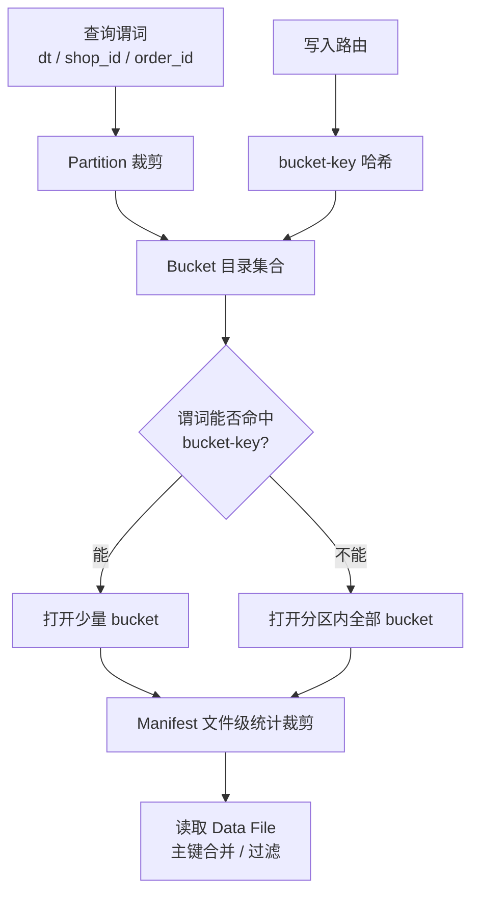

支付明细与订单事实表入湖之后，性能问题很少第一时间出在「Paimon 会不会算错 upsert」，而更常出在布局：分区切太粗导致每次对账扫半天；bucket 数拍脑袋导致小文件爆炸；或者某个头部店铺把单 bucket 撑到几十 GB，compaction 追不上，Lookup 变慢。业务表现是「大促后延迟」或「热点商户查询超时」，根因往往在 partition / bucket / 文件目录约定上。

本文以订单宽表 `dwd_order_wide`（主键 `order_id`，分区 `dt`，另有 `shop_id`）和支付成功表 `dwd_pay_success` 为例，把 partition、bucket、文件布局、裁剪路径，以及热点店铺导致的单 bucket 膨胀讲透。原理与案例约占四成，组件与布局级讨论约占六成。

## 业务场景：热点店铺把一个 bucket 写爆

链路是：

```text
订单 CDC -> Flink -> Paimon 主键表 dwd_order_wide
按 shop_id 做实时看板 Lookup / 按 dt 做日终对账
```

表最初这样建（示意）：

- 分区：`dt`
- 主键：`order_id`
- `bucket = 8`
- 未单独设 `bucket-key`，默认按主键哈希分桶

大促期间某头部店铺订单量占当天 30% 以上。表面看并行度「有 8 个 bucket」，但：

1. 该店铺订单的 `order_id` 虽然哈希分散，整体写入尚可；
2. 真正要命的是后续有人把 `bucket-key` 改成了 `shop_id`，想让「同店订单聚在一起」方便店铺画像；
3. 改完后，头部店铺几乎打进同一个 bucket，单 bucket 文件数与体积暴涨；
4. compaction 作业长期欠账，点查与部分聚合变慢，CDC sink 端反压。

这就是典型的 **业务亲和性布局 vs 写入均衡** 冲突。要解释清楚，得先把分区、bucket、目录和裁剪各自负责什么说开。

## 分区：业务裁剪的第一刀

### 分区字段怎么选

订单 / 支付域几乎总会有时间分区，常见是 `dt`，有时再加 `hour`。分区的核心价值是 **读侧跳过整棵子树**，不是「让目录好看」。

实践上：

- 日终对账、按天重跑补数：`dt` 足够；
- 强实时、按小时监控延迟：可考虑 `dt` + `hour`，但会放大小文件与元数据压力；
- 不要把高基数维度（如 `user_id`）直接当分区，目录会炸。

分区是路径的一部分：

```text
warehouse/db.db/dwd_order_wide/dt=2026-04-23/...
```

CDC 入湖时务必保证分区字段从业务时间正确推导。用「处理时间」填 `dt` 会导致跨天订单掉进错误分区，对账按业务日扫分区时出现系统性偏差——这不是引擎 bug，是分区语义选错。

### 分区与提交的关系

一次 commit 可以触及多个分区（补数作业一次修多天很常见）。manifest 会按分区记录文件归属。读侧谓词 `dt = '2026-04-23'` 应在规划阶段就把其他分区文件丢掉。若你发现对账扫了很多无关 `dt`，先查谓词是否下推，再查分区字段类型 / 格式是否一致（`2026-04-23` vs `20260423`）。

## Bucket：并行、合并与文件布局的基本单元

### bucket 是什么

在 Paimon 主键表里，bucket 大致承担：

- 写入并行单元：不同 bucket 可并行写；
- 主键合并单元：同一主键必须落在同一 bucket，才能在有限文件集合内完成 upsert 合并；
- 读并行与 compaction 粒度：很多任务按 bucket 切分。

目录形态常见为：

```text
dt=2026-04-23/bucket-0/
dt=2026-04-23/bucket-1/
...
```

每个 `bucket-N` 下是 data file（以及可能的 changelog、index、stats 等相关文件，视版本与表选项而定）。工程师看盘时，优先看「单 bucket 文件数」和「单 bucket 体积分布」，比只看表总大小更有诊断价值。

### bucket-key vs primary-key

这是最容易配错的一对概念：

- **primary-key**：定义行的唯一性与 upsert 语义。订单表通常是 `order_id`，支付表是 `pay_id`。
- **bucket-key**：定义「用哪些字段哈希到 bucket」。它可以是主键的全部或前缀，也可以是业务上希望聚拢的字段集合（在满足「同一主键始终同一 bucket」的约束下）。

约束必须记住：**同一主键的所有变更必须路由到同一 bucket**。因此 bucket-key 一般是主键的子集，或与主键有稳定函数关系的字段集合；千万不要用与主键无关且会漂移的字段当 bucket-key。

把 `bucket-key` 设成 `shop_id` 的动机通常是：店铺级查询更连续、更好裁剪。但若店铺极度倾斜，等于主动放弃均衡。更稳妥的做法往往是：

- bucket-key 仍用主键（或主键前缀）保证均衡；
- 店铺亲和性交给分区外的物理聚类、二级索引、或上游分流表；
- 若坚持 shop 亲和，就用更高的 bucket 数，并对头部店铺做单独表 / 单独分流。

### 固定桶与动态桶

固定 `bucket = N` 简单直观：创建表时定死，作业并行度也好估算。但业务量上涨后，N 过小会导致单 bucket 过大；N 过大又会产生过多小文件。

动态桶（dynamic bucket）相关能力的目标，是让桶数量随数据规模演进，减轻「一次拍死」的压力。使用时要关注：

- 元数据与赋值过程是否带来额外 commit / 协调成本；
- 读侧与下游作业是否假设了固定并行度；
- 倾斜场景下动态扩桶能不能真的拆开热点，还是只是整体变多但热点仍集中。

订单域上线动态桶前，建议先用历史 `shop_id` / `order_id` 分布做一次离线模拟：看 top 店铺在目标 bucket-key 下的集中度，而不是只看平均行数。

## 文件布局：目录里到底有什么

一张表在文件系统上，除了分区与 bucket 数据目录，还有元数据平面：

```text
.../dwd_order_wide/
  schema/
  snapshot/
  manifest/
  dt=.../bucket-.../   # 数据
  changelog/           # 视配置
```

对布局排障，建议分层看：

1. **snapshot**：可见性版本，不直接存行；
2. **manifest**：文件清单与统计，读计划的主要输入；
3. **bucket 目录**：真正的 orc/parquet 数据文件；
4. **changelog**（若开启）：给下游流读增量。

很多人只清数据目录不理解 manifest，结果「文件删了但元数据还指着」，或反过来「元数据以为文件还在」。运维动作必须走表正式的 expire / remove orphan 流程，而不是手搓 `rm`。

数据文件内部还有写侧带来的形态差异：append-only 与主键 upsert 的文件集合不同；compaction 前后，同一逻辑行的物理位置会变，但 snapshot 切换应保证读侧语义稳定。布局优化的本质，是让「有效文件集合」更少、更整齐，而不是让目录层数更少。

## 裁剪路径：从谓词到少开文件

读侧裁剪通常是多层的：

1. **分区裁剪**：`dt` 谓词直接减枝；
2. **bucket 裁剪**：若谓词能推到 bucket-key 等值 / IN 列表，可只打开相关 bucket；
3. **文件统计裁剪**：manifest 里的 min/max、null count 等挡掉不可能命中的文件；
4. **行级过滤与主键合并**：剩下的才真正读字节、合并多版本行。

支付对账 SQL 如果是 `WHERE dt = ? AND pay_status = 'SUCCESS'`，分区裁剪一定要生效；`pay_status` 能否做文件级裁剪，取决于统计信息是否收集、以及成功态是否在文件间区分明显。若几乎所有文件都混有成功与失败，状态谓词就裁不掉多少——这时更应回头看写入是否按状态分文件（通常不值得），或接受扫描成本。

店铺点查 `shop_id = ?` 在 bucket-key=`order_id` 时，往往 **无法 bucket 裁剪**，只能靠分区 + 文件统计 + 全 bucket 扫描合并。这是布局与查询模式不匹配的典型矛盾：写入均衡了，店铺点查变贵。解法应在产品层明确：点查走主键 / 专用索引表，而不是指望任意维度都能 bucket 裁剪。

## 倾斜案例：从改 bucket-key 到目录爆掉

把开头事故展开成可复盘的时间线：

1. **初期**：`bucket-key` 默认主键，`bucket=8`，写入大致均衡，单 bucket 几 GB 可接受；
2. **需求**：店铺画像团队希望同店数据物理聚拢，推动改 `bucket-key=shop_id`；
3. **大促**：头部店铺订单涌入单一 bucket，该 bucket 文件数短时间翻数倍；
4. **症状**：compaction CPU 打满但欠账仍增；CDC sink 反压；按店 Lookup 偶发超时；
5. **误判**：有人以为是「Flink 并行度不够」，把 sink 并行度加到 32，但表仍是 8 bucket 且热点集中，加压无助于热点 bucket；
6. **修复**：回退 bucket-key 到主键；头部店铺订单切到独立表或独立入湖通道；原表 bucket 数评估后上调，并加强单 bucket 体积监控。

关键教训：**sink 并行度 ≠ bucket 数 ≠ 热点可被打散**。并行度再高，路由到同一 bucket 的记录还是要串在同一合并单元里。

## 布局关系总览

下面用一张图把分区、bucket、文件与裁剪关系收束（全文仅此一个 mermaid）：



写侧决定数据落在哪棵子树，读侧决定能砍掉多少子树。两边用同一套 bucket-key / 分区语义对齐，否则一定会出现「写得很爽、读得很疼」或反过来。

## 组件与配置级讨论

### 建表时就要写进评审的项

订单表评审建议强制回答：

1. 分区字段与业务时间对齐方式；
2. 主键与 bucket-key 分别是什么，为何不是同一个；
3. 初始 bucket 数如何从日增量与目标单 bucket 体积反推；
4. top N 店铺 / 支付商户的倾斜系数；
5. 主要查询是按主键、按店铺、还是按天扫宽表；
6. compaction 与 expire 的责任人与监控项。

缺任何一项，后面多半会在大促用故障补课。

### 目录膨胀的常见原因

- bucket 过多 + commit 过勤 -> 小文件海；
- bucket 过少 + 热点 key -> 单目录过大；
- 分区过细（到分钟）-> 元数据与目录项爆炸；
- 失败重试留下孤儿文件 -> 总量看起来很大但有效数据没那么多；
- changelog 长期保留 -> 在「看起来是数据目录」之外又堆了一层。

治理顺序一般是：先停手搓删除，再看 snapshot / manifest 是否健康，再调 bucket 与 commit 频率，最后才考虑拆表。

### 与 CDC 入湖的配合

CDC 写入主键表时，删除与更新都要遵循同一 bucket 路由。若上游「修数」作业用另一套 bucket 计算方式（例如旧作业还按老 bucket-key 写），会出现同一主键进两个 bucket 的灾难：upsert 无法合并，对账出现双行。变更 bucket-key / bucket 数属于需要迁移计划的表结构演进，不是改个 with 参数就能热切换完事。

支付订正作业曾在迁移窗口两边各写了一段时间，结果同一 `pay_id` 分裂到两个 bucket。修复只能重放或专项合并，成本远高于当初做只读切换。

## 监控与容量：把倾斜变成可报警指标

建议至少盯这些量：

- 每分区下各 bucket 的文件数、字节数、行数的 **P50 / P95 / Max**；
- 单 bucket 最大体积相对均值的倍数（倾斜系数）；
- compaction 前后文件数变化与欠账时长；
- 读计划打开的 bucket 数、文件数（按作业类型分）；
- 分区数、manifest 文件数的增长曲线。

当 Max/Avg 持续大于某个阈值（例如 5x～10x），就要把「热点维度」拉出来看，而不是先加机器。订单域里，这个维度经常是 `shop_id`、某个渠道号、或某个活动入口。

## 目录布局细节：工程师上盘应该怎么看

假设表路径是 `warehouse/order_db.db/dwd_order_wide/`，一次排障可以按这个顺序看：

1. 看 `snapshot/LATEST` 与最近几个 snapshot 文件，确认表是否在正常提交；
2. 看 `manifest/` 是否短时间暴增（可能是小文件 / 频繁 commit / 冲突重试副作用）；
3. 进 `dt=当天/`，列出 `bucket-*` 目录，比较各目录体积；
4. 对体积异常的 `bucket-K`，看文件个数与单个文件大小分布：大量极小文件偏写放大，少数极大文件偏热点或 compaction 欠账；
5. 若开启 changelog，单独评估 changelog 目录是否比数据目录还夸张。

不要一上来就按 `order_id` 抽样猜倾斜。先用目录体积找出「哪个 bucket 不对劲」，再反查该 bucket 内 `shop_id` 分布。支付表同样适用：先找胖 bucket，再查是否某个渠道、某个收单机构、某个活动 id 占了大头。

### 文件命名与「看起来很多其实不可见」

数据目录里可能存在尚未被任何 snapshot 引用的文件（写成功但 commit 失败、或冲突重试留下的中间产物）。只看目录文件数会高估「有效数据」。有效集合必须以当前（或指定）snapshot 的 manifest 为准。订单值班里有人按目录文件数估算「今天又写了多少」，与对账行数对不上，原因就在这里。

## bucket 数怎么估：一个可用的粗糙公式

没有放之四海都准的公式，但订单域可以用这个起步算法：

1. 取近 7 天日增量行数中位数 `R`，以及目标单文件 / 单 bucket 可控体积（例如希望单 bucket 日增量对应数据在几百 MB 到几 GB 量级，视存储与 compaction 能力定）；
2. 用 `R / 单 bucket 目标行数` 得到粗算桶数 `N0`；
3. 用 top 店铺占比做修正：若最大店铺占比 `p` 很大，而 bucket-key 又与店铺相关，则有效桶数会被热点吃掉，需要要么改 key，要么对热点拆表，而不是只把 `N0` 乘个系数假装解决；
4. 再考虑读并行与作业并行：`N` 过小，下游按 bucket 切分的并行度上不去；`N` 过大，规划与小文件变差。

我们曾把某订单表从 8 桶调到 32 桶，平均变好，但头部活动日仍有 2～3 个桶明显更胖——因为主键哈希只能「统计上」均衡，不能消灭业务热点在其他维度上的集中。哈希均衡不等于业务均衡，这点要写进评审纪要。

## 动态桶：适合什么，不适合什么

动态桶吸引人的点是「不用一次拍死 N」。但在支付 / 订单主链路上，要额外问：

- 赋值与扩桶过程是否引入额外协调，是否与高峰写入叠加；
- 下游按固定 bucket 假设做的并发度配置会不会失效；
- 历史数据与新数据的桶映射是否需要迁移；
- 监控面板是否已按「可变桶」改造，而不是写死 bucket-0..7。

若团队还在为固定桶的倾斜、小文件、compaction 责任人扯皮，先把固定桶运营打磨清楚，再上动态桶，通常更稳。动态桶不是倾斜的自动解药：若 bucket-key 仍是热点店铺，扩出来的桶也可能继续被路由逻辑喂偏。

## 裁剪失败的几类现场

### 谓词写在了裁剪够不着的地方

例如把 `dt` 包在 UDF 里，或先 `cast` 再比较，导致分区裁剪失效，扫描从「一天」变成「全表」。订单对账 SQL 评审要像审索引条件一样审分区谓词形态。

### 以为 shop_id 能裁 bucket

只有 bucket-key 能支撑的等值 / IN 才有稳的 bucket 裁剪。`shop_id` 只是普通列时，最多指望文件级统计，而且统计若跨店混布，裁不掉多少。曾有报表同学认为「已经按店过滤还是慢」就是引擎不行，其实是布局与查询模式不匹配。

### 文件统计不给力

早年写入若未带齐统计，或某列几乎无区分度，min/max 裁剪接近无效。支付状态、布尔字段尤其如此。不要预期「随便一个 where 都能少读 90% 文件」。

## 热点店铺专项：拆表与分流

当单个 `shop_id` 长期占据极大比例，布局层手段会不够，需要业务分流：

- **热店独立表**：同一 schema，单独 bucket 规划与 compaction 资源；
- **上游分流**：CDC 作业按店名单拆成两条 sink，避免热店拖死共桶合并；
- **查询路由**：画像服务对热店走独立表，对长尾走主表。

这比在主表上反复改 bucket-key 更可控。支付域的大商户、订单域的头部店铺，本质是同一类容量问题。引擎提供桶与分区，不替你做业务分片战略。

## 变更 bucket 的迁移纪律

变更 `bucket` 数或 `bucket-key` 前后，建议强制执行：

1. 双写或只读切换窗口书面化；
2. 旧作业停止写入的确认（看 snapshot 的 commitUser）；
3. 新布局下抽样验证同一主键只落单桶；
4. 对账在迁移窗口按主键集合比对，而不是只比总数；
5. 保留回滚路径：发现双行立即停写新路径。

支付订正双行事故就是缺了第 3、4 步。总数可能仍接近，双行会在客诉级查询里爆出来。

## 布局与 CDC、补数、对账的接口契约

把布局相关约定写成表级契约，而不是口口相传：

- 分区字段语义（业务日，不是处理日）；
- bucket-key 与主键关系；
- 主写作业与补数作业名单；
- 允许的查询模式（主键点查 / 按日扫 / 不承诺按店秒级）；
- 单 bucket 倾斜告警阈值与值班人。

有了契约，大促前扩桶、加并行、拆热店才有共同语言。没有契约，每个人都会从自己的痛点改表：画像要按店聚拢，对账要按天扫得快，CDC 要写入均衡——三方目标互相打架，最终表现就是某次「只改一个 with 参数」的上线。

## 小结

Partition 负责业务时间与粗粒度裁剪，Bucket 负责主键合并与并行单元，文件布局是两者在磁盘上的投影。`bucket-key` 与 `primary-key` 分工不同：前者决定均衡与亲和，后者决定正确性。热点店铺案例说明，为查询亲和轻易改 bucket-key，可能把单 bucket 写成事故现场。

做布局决策时，把「主查询模式、倾斜分布、bucket 数、compaction 能力」放在一张表上评审；上线后盯单 bucket 分布，而不是只盯表总大小。目录上先找胖桶再查业务维度，动态桶与拆表分流要分清适用边界，变更桶策略必须带迁移纪律。这样支付 / 订单入湖才能在大促时稳住读写，而不是被目录和倾斜悄悄拖垮。

## 附录式实操：一次「胖桶」排查口述稿

接到「订单表变慢」工单时，可以按下面口述执行，避免一上来改参数：

第一，确认慢的是写入、compaction 还是某类查询。写入反压且某 bucket 文件数陡增，优先布局与热点；查询慢但写入平稳，优先裁剪与读计划。

第二，固定一个当天分区，导出各 bucket 字节数，算 Max/Avg。超过约定阈值，进入热点调查：在该胖桶抽样 `shop_id` 分布，看是否单店或单渠道独占。

第三，核对建表选项里的 `bucket-key` 与主键，确认近期有没有「为了店铺亲和」的变更。有变更就对照变更单看是否经过倾斜评估。

第四，看主查询是否假设了并不存在的 bucket 裁剪。若报表强依赖按店秒查，而桶键是订单主键，应把需求打回：走专用索引表或热店表，而不是逼主表改键。

第五，给出处置：短动能是扩 compaction 资源、限流补数；长动才是扩桶、改键迁移或拆热店。把「短长动」写进回复，减少各方同时拧同一颗螺丝。

这套口述稿在支付明细与订单宽表上都用过，比临时开脑洞改 `bucket=64` 更不容易制造二次事故。布局问题的可怕之处不在难，而在每个人都能改一个参数，却很少有人愿意先量分布。

补充一个容量规划口径：大促前不止看总 QPS，还要看「单店峰值订单占比」和「单渠道支付占比」。总流量翻倍但分布均匀，固定桶往往还能扛；总流量只涨三成但头部店铺占比从百分之五冲到百分之二十五，才是胖桶预警。把这两个占比和 Max/Avg 桶体积放在同一张大促看板，布局风险会早暴露几天，够你决定是临时拆热店，还是只加 compaction 资源硬扛。文件布局不是一劳永逸的建表选项，而是要跟着业务分布一起演进的运营对象；谁负责看胖桶，谁就对大促写入稳定性负第一责任。桶与分区定好了，并不等于一劳永逸：业务一变，布局就要重新量一遍。量过再改，改完再验收，这条闭环比任何「推荐 bucket 数」都重要。先量后改，始终是布局稳定性的底线。
