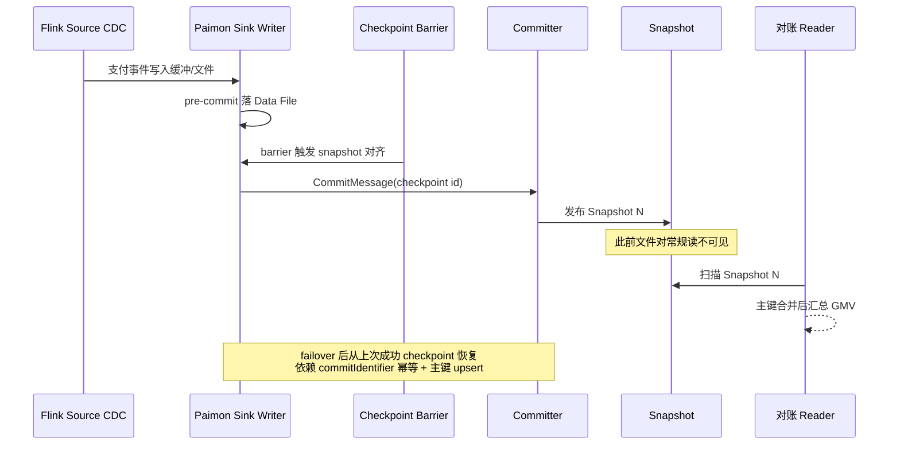

CDC 入湖要不要 exactly-once，往往在评审里被写成一句「用 Paimon + Flink 两阶段提交」。真上线后，问题会变得很具体：checkpoint 成功是否等于 snapshot 可见？Spark 批写挂了重跑会不会双写？failover 之后重复写入的行，到底靠谁吞掉？支付对账一旦对不上，这些语义细节就会从「架构图上的对勾」变成事故单里的根因栏。

本文以支付成功明细 `dwd_pay_success` 与订单状态 `dwd_order_status` 的入湖链路为例，把 Flink Sink 的两阶段提交、checkpoint 与 snapshot 的对应关系、Spark 批写提交，以及 failover 重复写靠主键合并消化的案例说清楚。原理与业务约占四成，组件与提交路径约占六成。

## 业务场景：failover 后对账多了一截

链路是：

```text
MySQL binlog -> Flink CDC -> Paimon 主键表 dwd_pay_success
整点 Spark 作业批写订正 / 补数到同一张表
下游 Flink 对账读 snapshot 做支付成功笔数与金额汇总
```

一次典型故障：

1. Flink 作业在 checkpoint `C` 附近 TaskManager 丢失，作业重启；
2. 重启后短时间写入量高于平时，对账任务看到成功支付笔数高于源库；
3. 再过一轮 compaction / 合并读取后，笔数又与源库对齐；
4. 与此同时 Spark 补数作业因输出提交失败整单重跑，日志里出现重复的 commit 尝试。

业务方的第一反应是「exact once 失效了」。更准确的描述通常是：**端到端对外可见的一致性，依赖「提交协议 + 主键合并 + 读 snapshot」三层一起工作**；中间某一层看到重复，并不等于最终表语义错了，但会在特定读窗口暴露成对账噪声。

## Exactly-once 在湖表上到底承诺什么

先把词用严一点。Flink 常说的 exactly-once **sink 语义**，指的是：在 checkpoint 成功的前提下，每次输入记录对 sink 的副作用只生效一次。落到 Paimon，通常意味着：

- 与某次 checkpoint 对齐的数据文件集合，要么完整进入某个 snapshot，要么不进入；
- 不会出现「一半文件可见」的中间态被常规 reader 读到；
- 重启后不会把「已成功提交」的同一 checkpoint 再提交成另一套增量（靠 commit identifier 等机制）。

它 **不自动消灭** 以下现象：

- 重启前已经写到文件系统、但未提交的垃圾文件（需 orphan 清理）；
- 主键表在合并前，多文件中存在同一主键的多版本；
- 读侧若跨快照或读到压缩过程中的错误假设，会看到短暂波动。

支付域要把「exactly-once」写成可验收条款时，建议写成：checkpoint 成功后，按对应 snapshot 读到的主键表最终状态与源库在水位内一致；而不是写成「任何时刻任何读法都不会看到重复」。

## Flink Sink 与两阶段提交

### 总体过程

Paimon 的 Flink 写入常见路径会把 sink 做成两阶段提交（two-phase commit）风格，与 Flink checkpoint 对齐：

1. **写阶段（类似 pre-commit）**：算子把记录写入 data file，形成待提交的 `CommitMessage`；文件已在文件系统，但表 snapshot 尚未发布，常规读者不可见。
2. **提交阶段（commit）**：checkpoint 完成屏障后，由 committer 把这批消息提交为新的 snapshot；成功后读者才能通过新 snapshot 看到数据。
3. **失败与恢复**：若在写阶段失败，恢复后重做；若在提交阶段失败，需要靠 `commitUser` + `commitIdentifier`（常与 checkpoint id 关联）做幂等，避免重复发布。

订单 CDC 作业里，可以把「一次成功的 checkpoint」近似理解成「一次成功的表事务提交边界」。近似的代价是：你还要确认 sink 并行实例的文件都进入同一次提交，而不是部分成功。

### checkpoint 与 snapshot 的对应

工程上最有用的对应关系是：

- 一个（成功的）checkpoint，通常对应一次（或按实现合并后的）Paimon commit；
- snapshot 元数据里能看到 `commitUser`、`commitIdentifier`，用于把湖表版本与 Flink 状态版本对上；
- 下游对账若要求「不读到 checkpoint 中间态」，应读已发布 snapshot，而不是去扫未引用文件。

注意：checkpoint 成功与「对账数字立刻等于源库」之间仍可能有业务水位差。binlog 延迟、CDC 解析延迟、以及你是否按事件时间对齐，都会造成「引擎语义对了，业务对账仍差几秒」。支付事故复盘时要把这两者拆开写，否则会在错误方向上改 sink。

### Committer 与并发

多并行 sink writer 时，通常是：writers 各自写文件，再由统一的 committer（或等效角色）汇总提交。冲突来源包括：

- 同表另有 Spark 作业在提交；
- 多个 Flink 作业共写；
- 提交过慢导致与后续 checkpoint 叠车。

冲突时应重试提交而非重写全部业务逻辑。若重试策略把「已成功 commit」当成失败，就会把 exactly-once 亲手打成 at-least-once，再交给主键合并擦屁股——能擦，但窗口期对账会疼。

## Spark 批写的提交语义

Spark 写 Paimon 常见是批作业：读源、转换、写文件、提交 snapshot，然后结束。它与 Flink 的差异在于：

- **没有持续 checkpoint 心跳**，提交边界往往是「作业成功结束」或显式的 commit 调用；
- 失败重跑默认是 **整作业重做**，更容易在「写文件成功、commit 失败」或「commit 成功、驱动端误判失败」时产生重复尝试；
- 与 Flink CDC 共写同一张支付表时，必须隔离 `commitUser`，并接受 commit 冲突重试。

批写订正支付金额时，我们使用的实践是：

1. 订正数据带主键 `pay_id`，依赖主键表 upsert；
2. 作业提交前查询最新 snapshot，提交后校验新 snapshot 的 identifier / 统计；
3. 若驱动端超时，先查 snapshot 是否已包含本次逻辑提交，再决定是否重跑；
4. 重跑必须是幂等订正（同一 `pay_id` 同一最终值），不能是「在旧值上再加一遍差额」。

第 4 点是业务语义，不是引擎能替你保证的。引擎保证的是文件与 snapshot 的事务边界；「金额加减是否幂等」是作业自己的契约。

## Failover 重复写：靠主键合并消化的案例

回到开头故障。Flink 在 checkpoint `C` 临近时挂掉，恢复后从上一成功 checkpoint `C-1` 的状态继续。于是：

1. 源端 CDC 从 `C-1` 对应的 binlog 位置重放；
2. 进入 sink 的支付事件有一部分与「挂掉前已写入但可能未提交 / 或已提交」的区间重叠；
3. 若挂掉前 **未完成 commit**，则重放产生的新文件会在新的 checkpoint 提交，读者不会看到旧垃圾文件；
4. 若挂掉前 **已完成 commit**，幂等提交应避免再提交同一 identifier；源端重放带来的同一 `pay_id` 再次 upsert，主键合并后值不变；
5. 对账任务若在「多版本文件尚未紧凑、且查询实现或缓存异常」或更常见地「读到了包含重复 upsert 过程的中间业务理解错误」时，会出现短暂偏高——多数情况下，用主键表最终语义按 snapshot 重读应对齐。

我们实际踩过的坑是：对账 SQL 用了近似去重（按文件行数加总）而不是按主键合并后的行集合计数，于是在 failover 后的小文件高峰期把「多版本行」当成「多笔支付」。改成真正的主键表计数（或基于 changelog 的有界最终一致口径）后，假性「多了一截」消失。

结论写进团队手册：

- **failover 后的重复投递，主键表靠 upsert 合并消化行级重复**；
- **exactly-once 提交协议负责的是 snapshot 边界与 commit 幂等，不是替你把错误的对账 SQL 变正确**；
- 观察指标应包括：重启后 snapshot 创建、同 identifier 重复提交尝试、对账口径是否按主键最终态。

## 提交与可见性时序

下面用一张图串起 Flink 两阶段提交与 snapshot 可见性（全文仅此一个 mermaid）：



抓住箭头含义：文件落盘不等于可见；可见以 snapshot 发布为准；恢复路径同时依赖提交幂等与主键合并。

## 组件级深挖

### Flink 侧状态与 commit 元数据

排障时同时看两份「版本」：

- Flink：checkpoint id、算子状态大小、sink 相关 metric；
- Paimon：snapshot id、`commitUser`、`commitIdentifier`、delta 文件数。

若 checkpoint id 已推进但 snapshot 长时间不动，问题在 committer / 元数据路径 / 冲突重试；若 snapshot 在动但对账不对，问题更可能在水位、口径、或共写。支付链路不要只盯 TaskManager 内存。

### Spark 侧的提交失败分类

把 Spark 写失败分成三类，处理完全不同：

1. **写文件阶段失败**：重跑即可，通常无可见脏读；
2. **commit 失败且确认未发布 snapshot**：可重跑，注意清理孤儿文件策略；
3. **commit 可能已成功但驱动端未知**：先查 snapshot，禁止盲目重做非幂等写入。

第 3 类是支付订正作业的高危区。曾有一次「金额差额修补」脚本在未知结果下重跑，把差额加了两次，主键合并也无法修复，因为两次写入的是两个不同的「最终值」语义（第二次仍是 +delta）。后来改成「写绝对金额」才具备幂等。

### 与主键表、changelog 的配合

若开启 changelog producer，下游流读看到的是变更日志，而不是只看最终快照。failover 期间 changelog 的产出与重复需要单独理解：最终表状态可合并正确，但 changelog 消费者若假设「严格一条支付成功事件只出一次」可能破功。支付下游若做「事件计数型」业务（发券、通知），更要明确消费的是 changelog 还是快照最终态。

## 工程实践清单

1. **一表一主写**：Flink CDC 主写，Spark 补数窗口化，错开高峰，commitUser 必隔离；
2. **提交幂等**：任何超时先查 snapshot / identifier，再重跑；
3. **对账口径**：按主键最终态，不按裸文件行数；
4. **水位**：对账等待业务时间 / watermark，不要只等作业 `FINISHED`；
5. **监控**：checkpoint 时长、commit 冲突、snapshot 速率、failover 次数、孤儿文件增长；
6. **演练**：定期杀 TM 做恢复演练，看对账曲线是否只有可解释的短窗口噪声。

## Flink 两阶段提交：writer 与 committer 的分工再展开

落到作业拓扑上，常见形态是多个 writer 子任务 + 一个（或少数）committer 角色：

- writer 只负责把自己收到的支付 / 订单记录写成文件，并在 checkpoint 时准备好 `CommitMessage`；
- committer 汇总各 writer 的消息，执行表级 commit，把文件集合挂进新 snapshot；
- Flink 的 checkpoint 成功，意味着这次两阶段协议在 Flink 看来走完了；Paimon 侧则应能看到对应 identifier 的 snapshot（或明确的空提交）。

排障时最忌只看 writer 日志里的「文件已写」。文件已写只说明 pre-commit 阶段有进展。若 committer 卡在冲突重试，下游对账仍可能停在旧 snapshot。支付值班建议把「最近一次成功 checkpoint id」和「最近一次 snapshot 的 commitIdentifier」打在同一张监控面板上，两者长时间分叉就要告警。

### 空提交与无数据 checkpoint

并非每次 checkpoint 都有新行。夜间订单低峰可能连续多次空提交。空提交是否产生新 snapshot、如何推进 identifier，要对照所用版本与配置理解，避免监控把「snapshot 速率下降」一律判成故障。更靠谱的是同时看源端延迟与 sink 端延迟：源端还有积压而 snapshot 不动，才是真问题。

### 并行度变更与状态兼容

Flink 作业改 sink 并行度、改最大并行度，可能影响状态恢复与写入并行布局。订单作业曾经为了提速盲目加并行，恢复时踩状态兼容问题，导致更长的停写窗口。提交语义正确性建立在「能稳定恢复」之上；恢复都失败，exactly-once 无从谈起。变更并行度要像变更主键一样走评审。

## Spark 批写：作业成功与表提交的缝

Spark 写路径通常在 driver 或等价协调点做最终 commit。这里有几条缝需要明确责任：

1. executor 写文件成功，driver 在 commit 前挂掉：重跑可能重复写文件，但若上次未 commit，读者仍看不到；需依赖孤儿清理与幂等业务写入。
2. commit 已成功，driver 在更新应用状态前挂掉：调度系统可能认为失败并重跑。此时必须先查 Paimon snapshot。
3. 与 Flink 共写冲突：Spark 侧应重试 commit，而不是立刻整作业失败回滚到「从头读源」。

支付补数作业把第 2 类缝补上之后，误重跑次数明显下降。具体做法是：提交后写一条「逻辑批次号 -> snapshot id」的外部记录（或直接以 snapshot 元数据为准），调度重试前先问这张映射。

### 批写主键表时的「最终值」契约

引擎提供 upsert，不提供「业务差额只加一次」的魔法。订正作业输入应尽量是：

- `pay_id` + 订正后的绝对金额 / 绝对状态；或
- 带版本号 / 订正单号的幂等键，由作业自己去重。

用「原金额 + delta」做输入，一旦 at-least-once 重跑，就会把钱加飞。这类事故与两阶段提交是否正确无关，却最常在「我们不是 exactly-once 吗」的质问里被混为一谈。写进规范：湖表提交语义解决的是文件与快照，不解决业务凭证是否幂等。

## 端到端「看起来 exactly-once」的验收方法

建议在预发用支付样例做三类验收，而不是只跑通作业：

**验收 A：正常 checkpoint 路径**

注入 N 笔支付成功，等 checkpoint，按新 snapshot 读主键表，笔数与金额与源一致。

**验收 B：TM failover 路径**

在写入高峰杀 TaskManager，恢复后等到新的成功 checkpoint，再读 snapshot；允许短窗口内运维噪声，但最终态应对齐；同时检查没有异常的重复 snapshot 提交（同一 identifier 不应反复生成多套有效增量）。

**验收 C：Spark 订正超时路径**

人为在 commit 成功后让 driver 报失败，触发调度重跑；作业应检测到已提交并跳过或做成幂等空跑，对账金额不变。

三类验收都过，才配在设计文档里写 exactly-once。只过 A 就上线，B/C 会在大促第一次翻车时补课。

## 重复写被主键合并消化：边界与代价

主键合并能消化的是：**同一主键的多次 upsert，最终留下正确版本**。它不能消化的是：

- 把一笔支付拆成两个不同 `pay_id` 再写进去；
- 非幂等的金额 delta 累加；
- changelog 消费者按事件计数触发副作用；
- 对账用错误口径把多版本行当成多笔。

代价方面，重复写即使最终态正确，也会带来：

- 更多小文件与更重的 compaction；
- manifest 更大，读规划更慢；
- failover 后短时间 IO / CPU 毛刺；
- 运维误判「写入量突增」。

所以「有主键就随便 at-least-once」不是好策略。提交协议能收紧的重复，尽量在 commit 层收紧；主键合并是安全网，不是主设计。

## 订单状态表上的一次联合复盘

订单状态表 `dwd_order_status` 同时接 Flink CDC 与夜间 Spark 状态修补。某次 failover 后，白天对账显示「支付成功但订单状态未到终态」的比例短暂升高。排查发现：

1. Flink 恢复重放期间，订单状态变更的提交节奏变慢；
2. 支付表先追上，订单表后追上，跨表对账窗口出现「支付有、订单无」；
3. 有人怀疑提交丢了状态，实际上是两表 snapshot 水位不一致。

修复不是改 exactly-once，而是对账改成「以业务水位对齐的两表 snapshot」或接受有界延迟。提交语义解决单表可见性；跨表一致性还要产品级水位策略。这是支付 / 订单域几乎必然碰到的下一层问题。

## 配置与运维上容易忽略的点

- **checkpoint 超时过短**：导致反复失败，sink 长期无法完成 commit，湖表可见性停滞。
- **checkpoint 间隔过短**：snapshot 过密，元数据压力大，和 Spark 共写更易冲突。
- **commit 重试无上限 / 无退避**：打满元数据路径，拖垮同仓库其他表。
- **忽略 orphan 文件增长**：磁盘成本与上市扫描成本被慢慢抬高。
- **把 Flink savepoint 与 Paimon snapshot 当成同一个东西**：二者相关但不等价，文档与值班话术要分开。

把这些写进 runbook，新同学看日志时才知道该问哪一层。

## 小结

Paimon 与 Flink 的 exactly-once，核心是 checkpoint 对齐的两阶段提交与 snapshot 发布；与 Spark 批写的核心是作业级提交边界与失败分类处理。failover 带来的重复写，在主键表上首先靠 commit 幂等避免重复快照，其次靠 upsert 合并消化行级重复。支付对账要同时验收正常路径、failover 路径与批写超时路径，并分清「引擎提交语义」「业务幂等契约」「跨表水位」三层责任，才能把「语义正确」从架构口号落成可运营的入湖链路。

## 把提交语义写进表级 SLA

最后建议把下面几条写进表级 SLA，而不是只写在某次评审纪要里：

1. 主写作业名称、commitUser、期望 checkpoint 间隔与超时；
2. 允许共写的补数窗口与最大冲突率；
3. 对账读取所依赖的水位定义（事件时间落后源库不超过多少分钟）；
4. failover 后多久内允许对账出现可解释噪声，以及噪声消失的判定方式；
5. 发现「commit 成功与否未知」时的标准动作：先查 snapshot，再决定重跑。

支付与订单是最容易把存储语义和业务情绪绑在一起的域。有了 SLA，值班同学才能在电话会议里说清：此刻是提交协议问题、是主键合并窗口问题，还是跨表水位问题。说不清分层，就会有人要求「重启作业赌一把」，而重启恰恰可能制造更多重复写与更多对账噪声。提交语义的工程化，不只是把两阶段提交跑通，而是把失败模式、验收方法和话术一起固化下来。

再补一段给架构评审用的判据：如果一份方案只能画出「Flink -> Paimon -> 对账」的幸福路径，却写不出 failover 后 identifier 如何幂等、Spark 超时后如何查 snapshot、跨表对账如何等水位，就不要勾选 exactly-once。把这三条判据当成门禁，比在上线后用客诉反推提交语义要便宜得多。主键表能合并重复行，并不豁免你把提交协议讲清楚；相反，正是因为合并会掩盖问题，才更需要在协议层把重复提交按住，把可解释的噪声窗口写进 SLA，而不是指望「最终总能对上」来安慰业务方。

实践里还可以再加一条发布检查：每次改 Flink checkpoint 参数、改 Spark 提交重试、改 commitUser，都要同步更新表级 SLA 与对账作业的等待条件。参数与口径脱节时，最常见的症状就是「作业都绿了，对账却红了」。绿的是引擎任务状态，红的是业务可见性约定——两者中间缺的那一截，往往就是本文反复强调的提交语义没有被当成产品契约来维护。把契约维护起来，Flink、Spark、Paimon 才能在同一张支付表上长期协作，而不是每次故障都重新解释一遍两阶段提交。对工程师而言，提交语义合格的标志很具体：出了 failover，你能指出对应 snapshot；遇到超时，你知道先查哪份元数据；对账红了，你能判断是水位、口径还是真的提交失败。做到这三点，exactly-once 才算从名词变成可交接的能力。也只有交接得出去，支付与订单入湖才不会绑在某几个「懂的人」身上：后来者按 SLA 与验收清单就能判断故障落在哪一层，该查 checkpoint、查 snapshot，还是查对账口径，而无需重新从两阶段提交的定义讲起。把这些写进仓库文档与值班手册，比只写在聊天记录里更耐用；提交语义一旦可交接，exactly-once 才算真正交付完成。此后再谈优化 checkpoint 或批写吞吐，才有共同前提。否则吞吐数字很好看，故障时仍然说不清可见性边界，对支付对账没有实际帮助。先把边界讲清楚，再谈性能优化与并行度调整，这才是支付与订单入湖链路应当长期坚持的基本工程顺序。
